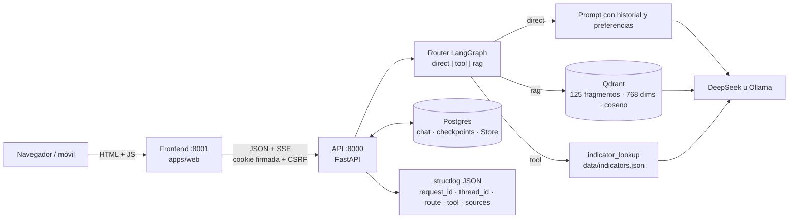
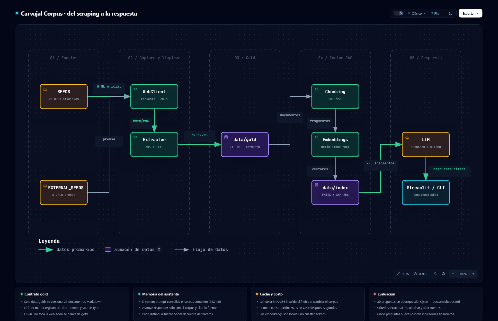
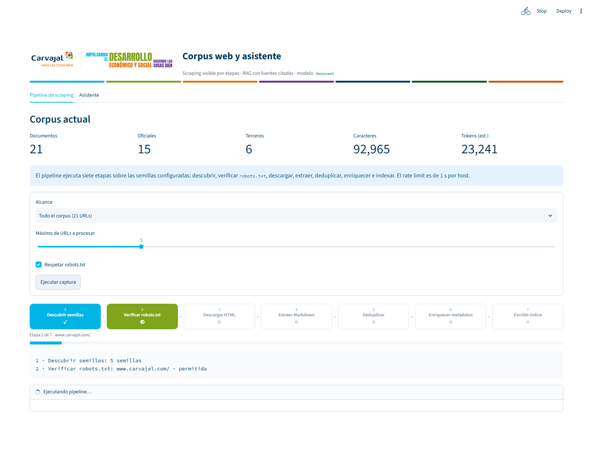
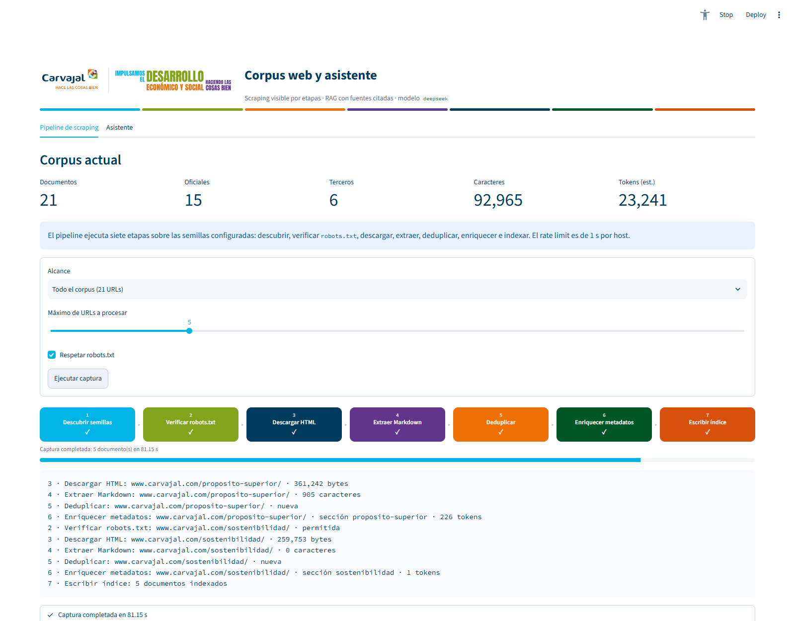
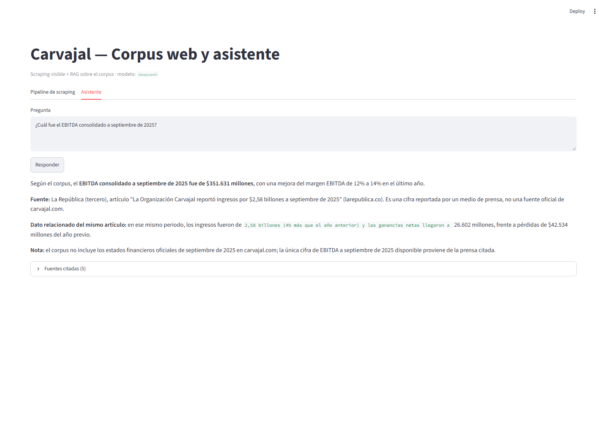
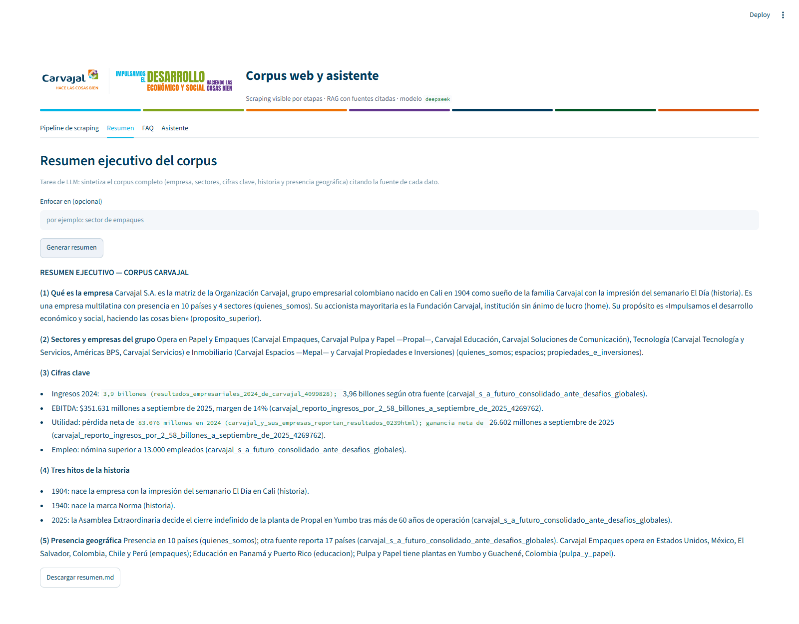
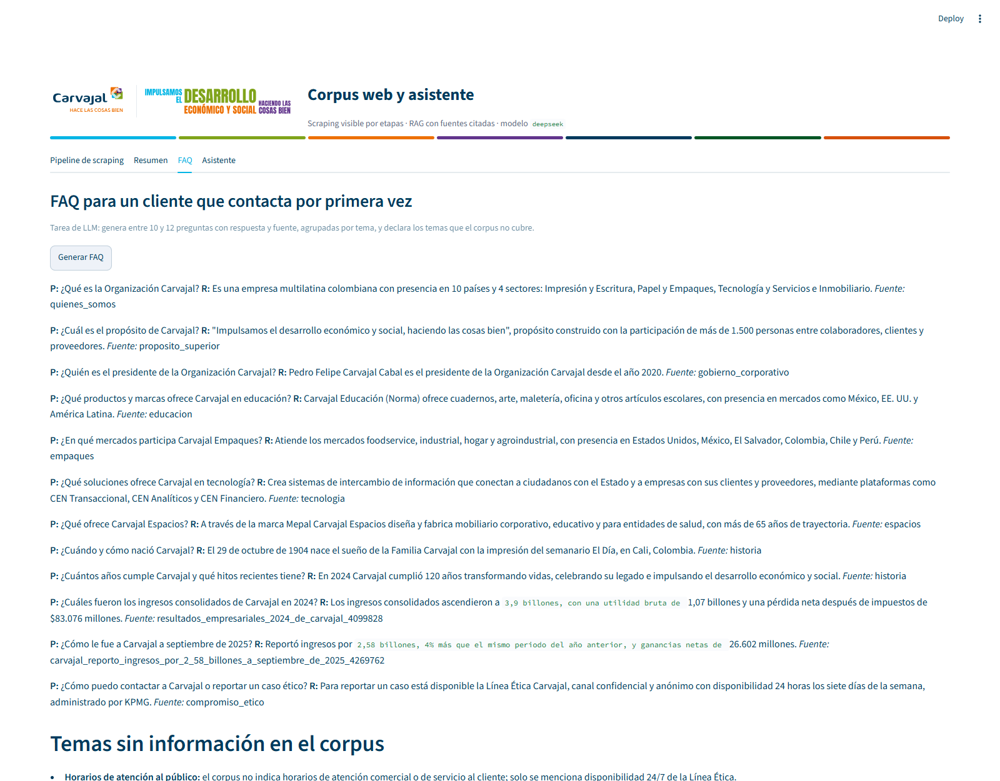

# Carvajal — Corpus Web

[](https://github.com/markodavid/carvajal/actions/workflows/ci.yml)
[](https://www.python.org/)
[](https://docs.astral.sh/uv/)
[](https://docs.astral.sh/ruff/)
[](LICENSE)

> Pipeline de captura y curaduría del corpus web de **Carvajal** para RAG.

## Descripción

Convertir las páginas públicas del sitio web de Carvajal en un corpus Markdown
citable, reproducible y listo para un pipeline de RAG, respetando `robots.txt` y
sin depender de una API del sitio.

## Problema y solución

**Problema.** Responder preguntas sobre una empresa exige un corpus fiable: los datos
están dispersos en el sitio corporativo, algunos indicadores solo se publican en PDFs o
detrás de contadores JavaScript, y cualquier modelo sin contexto inventa cifras.

**Solución.** Un pipeline reproducible que captura el sitio oficial y fuentes de prensa,
los normaliza en tres capas (bronze → silver → gold), los indexa con embeddings locales
y responde con un LLM **citando la fuente y distinguiendo** lo oficial de lo publicado por
terceros. Todo se demuestra en una interfaz con el scraping visible etapa por etapa.

| Antes | Después |
|---|---|
| Corpus de 2.45 MB con menús duplicados | **64.5 KB** de texto editorial tras corregir el extractor |
| Sin indicadores financieros (solo PDFs/JS) | **24 documentos** con ingresos, EBITDA, márgenes y empleo |
| Respuestas sin trazabilidad | Cada respuesta **cita medio, fecha y tipo de fuente** |
| Arranque de la app en ~5 min (embeddings) | **Segundos**, con índice persistido e invalidación por hash |

## Entrega M2 — agente con Qdrant, memoria y herramienta

La entrada oficial del Módulo 2 es el **frontend propio** en
<http://localhost:8001>; la API vive en <http://localhost:8000>. Son dos
procesos: el navegador habla HTTP/SSE con la API y esta concentra credenciales,
modelo, ruta, memoria y herramientas.



### Arranque reproducible (dos terminales)

```bash
# Preparación única
uv sync --all-extras
cp .env.example .env                 # completa DEEPSEEK_API_KEY y SESSION_SECRET
make db                              # Postgres 16 + pgvector
make qdrant                          # Qdrant con volumen persistente
uv run alembic upgrade head          # migraciones, incluida 0005
ollama pull nomic-embed-text         # embeddings locales de 768 dimensiones
uv run carvajal migrate-gold         # importa documentos y fragmentos a Postgres
make index                           # indexa data/gold en Qdrant (idempotente)

# Terminal 1: API
make api                             # http://localhost:8000

# Terminal 2: frontend propio
make web                             # http://localhost:8001  ← entrada del M2
```

`make index` reejecuta la indexación con IDs UUID5 estables y poda los puntos
obsoletos; `uv run carvajal index-qdrant --recreate` reconstruye la colección
desde cero. El arranque web no indexa: funciona con un índice ya preparado.
`/live` comprueba el proceso y `/health` publica documentos, fragmentos y estado
de Qdrant por separado.

### Contrato del turno

`POST /api/chat/stream` acepta `question`, `csrf_token`, `client_turn_id` y
`thread_id` opcional. Emite SSE con estos eventos:

| Evento | Contenido |
|---|---|
| `open` | Apertura del stream. |
| `trace` | `thread_id`, `route` (`direct`/`tool`/`rag`), `intent`, `tool`, `memory`, `retrieved`. |
| `meta` | `sources[]` con `chunk_id`, `slug`, `title`, `url`, `source_type`, `score` y extracto. |
| `token` | Fragmento incremental de la respuesta. |
| `fallback` | Respuesta completa si el stream falla antes del primer token. |
| `done` | `conversation_id`, `message_id`, `thread_id`, `route`, `elapsed_ms`. |
| `error` | Mensaje accionable e `incomplete`; un 4xx/5xx SSE no se reintenta solo. |

El mismo contrato existe en el shell Jinja2 (`/chat/stream`) para compatibilidad,
y `GET /api/chat/history` devuelve el hilo activo al recargar.

### Memoria, herramienta y router

- **Corto plazo:** `PostgresSaver` con `thread_id = conversations.id`, verificado
  contra el dueño de la cookie. El historial de Postgres siembra el estado si el
  checkpoint no existe; un reinicio del backend recupera el mismo hilo.
- **Largo plazo:** `PostgresStore` en el namespace `("carvajal", "preferences",
  owner_key)`. Una preferencia declarada se recupera en otro hilo del mismo
  dueño y no cruza a otro visitante.
- **Herramienta:** el nodo `tool` invoca `indicator_lookup` con `@tool` y
  `args_schema` Pydantic sobre `data/indicators.json`. Devuelve valor, unidad,
  cita y URL, o una ausencia explícita.
- **Router:** orden documentado en `carvajal/agent/router.py`: preferencia →
  herramienta con período explícito → saludo/capacidad → RAG (seguimiento
  elíptico reescrito con la pregunta anterior) → abstención si falta evidencia.
  Los saludos no tocan Qdrant ni la herramienta.

La expansión de consulta usa fechas y entidades que el corpus ya declara
(`1904 Cali Colombia`, `10 países`, `13.000 empleados`) y las fichas de
`data/retrieval_cards.json` solo ayudan a recuperar; la cita siempre sale del
fragmento original.

### Evaluación

`data/eval/retrieval_questions.json` contiene 31 consultas etiquetadas a mano
(30 con evidencia y una sin evidencia). El reporte reproducible está en
[`docs/eval/retrieval-report.md`](docs/eval/retrieval-report.md). El JSON
completo con los 10 resultados por consulta se regenera con el mismo comando y
no se versiona para no inflar el PR.

```bash
make index-eval     # indexa y ejecuta scripts/eval_retrieval.py
```

Resultado de la última corrida (Qdrant, k=10): **Recall@10 = 0.8000**,
**nDCG@10 = 0.7791**; la consulta sin evidencia (`q31`, teléfono en Tokio) se
abstiene sin fuentes. La evaluación separa retrieval de calidad de respuesta:
no llama al LLM.

## Stack

| Categoría | Tecnología |
|-----------|------------|
| **Lenguaje** | Python 3.13+ |
| **Gestor de paquetes y entorno** | [`uv`](https://docs.astral.sh/uv/) |
| **Build backend** | `uv_build` (src-layout) |
| **Paquete Python** | `carvajal` |
| **HTTP** | `requests` (sesión única, `User-Agent` identificable, `timeout`) |
| **Parseo HTML** | `beautifulsoup4` + `lxml` |
| **RAG web (M2)** | Qdrant + LangGraph + Postgres (checkpointer y Store) |
| **RAG legado** | LangChain + FAISS + Streamlit (prototipo, no es la entrada del M2) |
| **LLM** | DeepSeek (`deepseek-chat`), Anthropic Claude u Ollama (`llama3.2`) |
| **Interfaz de pruebas** | Streamlit |
| **Tipado estático** | [`ty`](https://github.com/astral-sh/ty) |
| **Testing** | [`pytest`](https://docs.pytest.org/) |
| **Linting / Formato** | [Ruff](https://docs.astral.sh/ruff/) |
| **Pre-commit** | [pre-commit](https://pre-commit.com) |
| **CI/CD** | [GitHub Actions](.github/workflows/ci.yml) |
| **Dependencias automáticas** | [Dependabot](.github/dependabot.yml) |

## Fuentes del corpus

| Origen | Dominio | Aporte |
|---|---|---|---|
| Sitio oficial | `carvajal.com` | Misión, historia, sectores, gobierno corporativo, sostenibilidad |
| Prensa económica | `larepublica.co`, `elpais.com.co`, `caliescribe.com` | Ingresos, EBITDA, márgenes, utilidad neta, activos, pasivos, patrimonio, empleo |
| Corpus extendido (colaborativo) | `carvajalempaques.com`, `carvajaleducacion.com`, `mepal.com.co`, `cencarvajal.co`, fundaciones… | Productos, políticas, sedes y páginas de las filiales que el sitio matriz no cubre |

Los documentos de terceros se marcan en el *front matter* con `source_type: tercero`, los
del corpus extendido con `source_type: colaborador`, y el asistente está instruido para
atribuir cada cifra a su medio y fecha.

## Pipeline de captura

```text
semillas (24 URLs)
   │  robots.txt + rate limit (1 s/host) + User-Agent propio + timeout 30 s
   ▼
Bronze  data/raw/*.html          HTML crudo, tal como llegó
   ▼
Silver  data/processed/*.md      Markdown limpio (sin menús, header ni footer)
   ▼
Gold    data/gold/*.md           Markdown + front matter (url, title, section,
                                 domain, source_type, captured_at, hash, chars)
   ▼
Índice  data/gold/index.jsonl    una línea por documento (URL, sección, hash, tokens)
```

- **Deduplicación** por huella SHA-256 del contenido; las páginas casi vacías
  (< 200 caracteres) no se deduplican para no perder secciones distintas.
- **Enriquecimiento**: `section` se deriva de la URL del sitio oficial (`inversionistas`,
  `quienes-somos`…) y es `prensa` en las fuentes de terceros; `hash` y `chars` describen
  cada documento.
- **Métricas**: al terminar, `carvajal capture` reporta descubiertas, descargadas,
  escritas, descartadas (robots, duplicadas, errores), caracteres, tokens estimados y
  duración.

## Corpus extendido (capa de recuperación)

El núcleo (`data/gold/`) es el corpus curado que se consolida en el prompt. Encima se
importa un **corpus externo** que solo participa en la recuperación: no se copia al
prompt, se cita por fragmento con su URL y su categoría.

```bash
make import
# o: uv run carvajal import
```

La ruta del donante se configura con `EXTERNAL_CORPUS_DIR` (por defecto
`../proyecto-carvajal`). La importación usa categorías y presupuesto fijos de
`config.py`, re-extrae el HTML Bronze con el extractor propio y **no importa PDF**;
si el HTML no deja texto suficiente, usa el Silver del donante como respaldo.

| Aspecto | Núcleo | Capa extendida |
|---|---|---|
| Ruta | `data/gold/*.md` | `data/external/<fuente>/gold/*.md` |
| Prompt | Sí, completo | No, solo fragmentos recuperados |
| Procedencia | `source_type: oficial\|tercero` | `source_type: colaborador`, `origin`, `category`, `entity` |
| Versionado en Git | Sí | No: se regenera con `carvajal import` (solo se versiona el manifiesto) |
| Selección | Semillas de `config.py` | Categorías fijas de `EXTERNAL_CATEGORIES` |

La importación es idempotente: reconstruye la salida desde cero, descarta las URLs que
ya están en el núcleo y deduplica por URL normalizada y hash del texto. Escribe
`manifest.json` con la fuente, la captura donante y los conteos por categoría.

> La capa extendida es material de terceros: conserva la atribución y no se presenta como
> comunicación oficial de Carvajal.

## 🗺️ Arquitectura

Diagrama interactivo autocontenido (generado con [Archify](https://github.com/tt-a1i/archify)):
pan/zoom, búsqueda de componentes, tema claro/oscuro y exportación. Ábrelo en el
navegador: [`docs/arquitectura.html`](docs/arquitectura.html). La fuente tipada y
versionada es [`docs/arquitectura.json`](docs/arquitectura.json), y la versión Mermaid
está en [`docs/arquitectura.md`](docs/arquitectura.md).

[](docs/arquitectura.html)

## Instalación

```bash
# Clonar el repositorio
git clone git@github.com:markodavid/carvajal.git
cd carvajal

# Sincronizar el entorno (crea .venv e instala dependencias)
uv sync --all-extras
```

> `--all-extras` instala también los extras `capture` (HTTP y extracción HTML
> para la CLI) y `legacy` (Streamlit y FAISS). La app web y su imagen Docker
> solo necesitan las dependencias base.

## Uso

> El CLI (`carvajal capture`, `status`, `ask`, `eval`, `summarize`, `faq`,
> `import`, `migrate-gold`) requiere los extras de captura y prototipo:
> `uv sync --all-extras` en el repositorio, o
> `uv tool install "carvajal[capture,legacy]"` fuera de él. La imagen Docker
> solo instala el runtime web y no incluye el CLI.

```bash
# Capturar el sitio oficial y las fuentes de terceros
# (descubrir → extraer → limpiar → deduplicar → enriquecer)
uv run carvajal capture

# Solo el sitio oficial / solo fuentes de terceros
uv run carvajal capture --scope oficial
uv run carvajal capture --scope terceros

# Ajustar el rate limit o ignorar robots.txt (solo pruebas locales)
uv run carvajal capture --delay 2.0
uv run carvajal capture --ignore-robots

# Ver el estado del corpus (documentos, origen, tokens, índice)
uv run carvajal status

# Listar semillas
uv run carvajal list

# Preguntar al corpus (RAG)
uv run carvajal ask "¿En qué consiste el fondo de inversión de Carvajal?"

# Tareas de LLM sobre el corpus completo
uv run carvajal summarize            # resumen ejecutivo -> docs/resumen.md
uv run carvajal summarize --focus empaques
uv run carvajal faq                  # FAQ de cliente -> docs/faq.md

# Interfaz web: pipeline visible + las tres tareas
uv run streamlit run app.py     # o: make app

# Evaluación: 25 preguntas de prueba -> docs/resultados.md
make eval
```

### Interfaz web del M2

La entrada oficial del Módulo 2 es <http://localhost:8001> (`make web`), con la
API en <http://localhost:8000> (`make api`). El frontend ofrece cuatro pestañas
superiores —**Asistente**, **FAQ**, **Corpus** y **Documento**— con URLs estables
(`/`, `/faq`, `/corpus` y `/documents/{id}`) y conserva el hilo del chat al navegar.
Corpus y Documento leen los endpoints JSON `/api/corpus` y
`/api/documents/*`, que reutilizan los mismos proveedores y el saneamiento
`nh3` de las vistas HTML. El shell Jinja2 sigue disponible en
<http://localhost:8000/chat> para pruebas y mantiene el mismo contrato SSE; su
pestaña **FAQ** (`/faq`) consume el mismo endpoint `/api/faq` y ofrece la misma
experiencia de lotes de 10. Sus pantallas comparten la cabecera, la paleta y los
componentes visuales del frontend del M2. El texto generado se formatea con Markdown saneado, las
fuentes se pliegan por defecto y cada cita abre un panel lateral con el
documento en el fragmento citado. El chat mantiene el compositor abajo, un
panel de hilos anteriores y la pestaña **Configuración** para subir documentos
o carpetas y para capturar páginas web por semillas o URLs: Bronze → Silver →
Gold → PostgreSQL → Qdrant, reutilizando el pipeline del corpus y conservando
los documentos ya indexados. La captura muestra el progreso por SSE, respeta
`robots.txt` y valida las URLs contra un guard SSRF; en esta fase la carga y la
captura son públicas y no exigen autenticación.

La pestaña **FAQ** genera hasta 10 preguntas frecuentes por lote con el corpus
núcleo completo y las agrupa por tema con su fuente. El botón **Generar otras
10** pide un lote nuevo, excluye las preguntas ya mostradas y acumula el
resultado en la pestaña; **Descargar faq.md** produce el Markdown equivalente.
La generación usa SSE, comparte el CSRF y la cuota diaria del chat y avisa
cuando el corpus se truncó por longitud. Con Ollama, la ventana de contexto se
configura con `OLLAMA_NUM_CTX` (32 768 tokens por defecto) para que el corpus
completo quepa en el prompt.

### Interfaz legada (Streamlit)

> El prototipo Streamlit conserva las tareas del Módulo 1 y no es la entrada del
> M2. Se retira en la ola 7 del plan de migración.

`uv run streamlit run app.py` abre cuatro pestañas:

| Pestaña | Qué muestra |
|---|---|
| **Pipeline de scraping** | Ejecuta la captura en vivo con las 7 etapas (descubrir → `robots.txt` → descargar → extraer → deduplicar → enriquecer → indexar), el log por etapa y las métricas: descubiertas, descargadas, escritas, descartadas (con motivo), caracteres, tokens y duración. Arriba, el estado del corpus Gold. |
| **Resumen** | Tarea de LLM: resumen ejecutivo del corpus completo (empresa, sectores, cifras con año y fuente, hitos, presencia). Opcional: enfocar en un tema. Descargable como `resumen.md`. |
| **FAQ** | Tarea de LLM: 10-12 preguntas frecuentes de un cliente primerizo, con respuesta y fuente, agrupadas por tema, más una sección de **temas que el corpus no cubre**. Descargable como `faq.md`. |
| **Asistente** | Tarea de LLM (Q&A): pregunta y respuesta RAG con **fuentes citadas**: dominio, tipo de fuente (oficial/tercero/colaborador), capa (núcleo/extendido), categoría y fragmento recuperado. Avisa si el índice vectorial está desactualizado. |

La captura es idempotente: si el contenido de una página no cambia, su `hash` se repite y el
índice FAISS **no se invalida**, así que se puede ejecutar la demo sin esperar la reconstrucción.

### Capturas

**Pipeline de scraping** — el diagrama de bloques se ilumina etapa por etapa mientras corre la
captura (naranja = etapa activa, verde = completada, gris = pendiente):

[](docs/ui-pipeline.png)

**Métricas de la captura** — las siete etapas completadas y el resumen de la corrida:

[](docs/ui-metricas.png)

**Asistente** — respuesta con fuentes citadas y atribución oficial/tercero:

[](docs/ui-asistente.png)

**Resumen ejecutivo** (tarea de LLM) — cinco bloques, cada cifra con su fuente y «no consta
en el corpus» cuando falta el dato:

[](docs/ui-resumen.png)

**FAQ** (tarea de LLM) — 12 preguntas con respuesta y fuente, más los temas que el corpus no
cubre:

[](docs/ui-faq.png)

La identidad visual usa el **logo oficial en SVG** (`assets/carvajal-logo.svg`) y la paleta
de marca del sitio (`#00B5E5`, `#80A41B`, `#ED7004`, `#62358C`, `#003A5D`, `#015625`),
configurada en `.streamlit/config.toml` e inyectada como CSS en la app.

## Configuración del LLM

Copia el archivo de ejemplo y completa tu clave (`.env` está en `.gitignore`):

```bash
cp .env.example .env
```

```ini
LLM_PROVIDER=deepseek
DEEPSEEK_API_KEY=sk-...
DEEPSEEK_MODEL=deepseek-chat
```

También puedes configurar las variables en la terminal:

| Variable | Descripción | Default |
|----------|-------------|---------|
| `LLM_PROVIDER` | Proveedor LLM: `ollama`, `deepseek` o `claude`. | `ollama` |
| `DEEPSEEK_API_KEY` | Clave API de DeepSeek (solo si `LLM_PROVIDER=deepseek`). | `""` |
| `DEEPSEEK_MODEL` | Modelo DeepSeek a utilizar. | `deepseek-chat` |
| `DEEPSEEK_BASE_URL` | Endpoint compatible con OpenAI. | `https://api.deepseek.com/v1` |
| `ANTHROPIC_API_KEY` | Clave API de Anthropic (solo si `LLM_PROVIDER=claude`). | `""` |
| `CLAUDE_MODEL` | Modelo Claude a utilizar (p. ej. `claude-sonnet-4-5`). | `claude-sonnet-4-5` |
| `OLLAMA_MODEL` | Modelo local para el chat y la FAQ. | `llama3.2` |
| `OLLAMA_NUM_CTX` | Ventana de contexto de Ollama; debe caber el prompt de la FAQ. | `32768` |
| `QDRANT_URL` | Endpoint de Qdrant. | `http://127.0.0.1:6333` |
| `QDRANT_COLLECTION` | Colección del índice M2. | `carvajal_chunks` |
| `QDRANT_DIMENSIONS` | Dimensión de los embeddings. | `768` |
| `RAG_TOP_K` | Fragmentos que recibe el prompt. | `6` |
| `RAG_MIN_SCORE` | Umbral mínimo de similitud. | `0.30` |
| `AGENT_CHECKPOINTER` | `postgres` o `sqlite` para la demo local. | `postgres` |
| `FRONTEND_ORIGINS` | Orígenes CORS del frontend separado. | `http://localhost:8001,...` |
| `CARVAJAL_API_BASE` | URL de la API para `config.js` y la CSP del frontend; obligatoria fuera de `localhost`/`127.0.0.1`. | `http://localhost:8000` |
| `CAPTURE_DEFAULT_URLS` | Valor inicial del máximo de URLs por captura. | `5` |
| `CAPTURE_MAX_BYTES` | Tamaño máximo de una respuesta capturada. | `5000000` |
| `CAPTURE_TIMEOUT_SECONDS` | Timeout por petición de la captura. | `30` |
| `CAPTURE_MAX_REDIRECTS` | Saltos de redirección permitidos y revalidados. | `5` |
| `CAPTURE_REQUESTS_LIMIT` | Capturas por IP y ventana; `0` desactiva el límite. | `5` |
| `CAPTURE_WINDOW_SECONDS` | Ventana en segundos del límite por IP. | `3600` |
| `CAPTURE_ALLOWED_DOMAINS` | Allowlist opcional separada por coma; vacía = cualquier host público. | vacío |
| `CAPTURE_ALLOW_PRIVATE_HOSTS` | Solo desarrollo: permite loopback y redes privadas. | `false` |

> Los embeddings se calculan localmente con Ollama (`nomic-embed-text`),
> independientemente del proveedor del LLM. `make index` requiere ese modelo.

Para la app web, `SESSION_SECRET` firma la cookie anónima. En producción es
obligatorio (`compose.prod.yml` falla si falta). En desarrollo, fíjalo también
si vas a reiniciar el backend durante la demo: con un secreto aleatorio por
proceso, la cookie deja de validar y el hilo no se recupera. El shell genera
además un hash de 256 bits en `localStorage` la primera vez que visita cada
navegador, lo refleja en la cookie `carvajal_visitante` y el servidor deriva el
dueño con HMAC; así recupera sus hilos aunque se pierda la cookie firmada. No
es autenticación: el hash es un identificador anónimo portador.
`DAILY_REQUESTS_LIMIT` y `QUOTA_TIMEZONE` configuran la cuota diaria;
`POSTGRES_*`/`DATABASE_URL` configuran la base.

El índice vectorial FAISS se guarda en `data/index/` (ignorado por Git) y se reutiliza
mientras el corpus no cambie, de modo que la app arranca en segundos. La primera
ejecución calcula los embeddings desde cero (varios minutos en CPU). Para forzar el
recálculo, borra `data/index/`.

Ejemplo con DeepSeek vía API:

```bash
$env:LLM_PROVIDER = "deepseek"
$env:DEEPSEEK_API_KEY = "<tu-clave-de-deepseek>"
$env:DEEPSEEK_MODEL = "deepseek-chat"
uv run carvajal ask "¿Cuál es la misión de Carvajal?"
```

## Calidad

```bash
make install    # uv sync --all-extras
make dev        # install + pre-commit install
make check      # lint + formato + tipos + pruebas
make lint       # Ruff (lint)
make format     # Ruff (formato)
make typecheck  # ty
make test       # pytest
make build      # uv build
make image      # imagen Docker de la app web
make prod-up    # app + base + Qdrant + Ollama en APP_PORT (requiere SESSION_SECRET)
make prod-down  # detiene los servicios (conserva los volúmenes)
make db         # Postgres 16 con pgvector (docker compose)
make db-down    # detiene la base local
make clean      # limpiar cachés y artefactos
```

## Imagen Docker

```bash
make image                  # docker build -t carvajal-api:local .
export SESSION_SECRET="$(python -c 'import secrets; print(secrets.token_urlsafe(32))')"
export APP_PORT=8080        # puerto público de la demo
make prod-up                # app + Postgres + Qdrant + Ollama
docker compose -f compose.prod.yml run --rm app alembic upgrade head
```

La imagen es multi-etapa, corre con un usuario sin privilegios y solo instala
las dependencias del runtime web; los extras `capture` y `legacy` se quedan
fuera. El build fija las imágenes base por digest y omite `zstandard`
(compresión opcional de trazas de LangSmith) y las herramientas de build (`uv`,
`pip`) para mantenerse por debajo de 300 MB. `compose.prod.yml` exige
`SESSION_SECRET` (falla si falta) y endurece el contenedor con `read_only`,
`cap_drop: ALL` y `no-new-privileges`.

En producción el despliegue es automático al fusionar el PR de release en
`main`: GitHub Actions publica la imagen en GHCR con un tag `sha-<commit>` y
`scripts/deploy.sh` la descarga en el VPS, aplica migraciones y comprueba
`/live` y `/health`. La demo se publica directamente en `http://IP:APP_PORT`
(8080 por defecto), sin dominio ni TLS. El runbook —VPS, secretos, primer
despliegue, respaldos y rollback— está en
[`docs/despliegue-ovh.md`](docs/despliegue-ovh.md).

| Ruta | Qué comprueba | Depende de Postgres |
|---|---|---|
| `GET /live` | Que el proceso responde (liveness del contenedor). | No |
| `GET /health` | Conteos de documentos/fragmentos y estado de Qdrant (readiness). | Sí |
| `GET /api/health` | El mismo readiness para el frontend propio. | Sí |

La demo no lleva proxy TLS: la app se publica en `0.0.0.0:APP_PORT` (8080 por
defecto) y se accede por `http://IP:8080`. Si más adelante pones un dominio, usa
nginx/Caddy delante, publica la app solo en `127.0.0.1:8000` y ajusta
`FORWARDED_ALLOW_IPS` a la IP del proxy. De ello dependen las cookies `Secure`,
HSTS y la cabecera CSRF cuando hay TLS.

## Estructura

```text
carvajal/
├── apps/
│   ├── api/        # FastAPI, contrato HTTP/SSE y shell Jinja2
│   └── web/        # frontend propio del M2 (:8001)
├── packages/core/src/carvajal/
│   ├── agent/      # router, herramienta, memoria y grafo LangGraph
│   ├── indexing/   # Gold → Qdrant
│   └── adapters/   # storage, embeddings, LLM y vector (pgvector/Qdrant)
├── tests/
├── data/
│   ├── gold/       # entregable versionado (capa gold)
│   ├── eval/       # consultas etiquetadas del retrieval
│   ├── indicators.json      # herramienta del M2
│   └── retrieval_cards.json # fichas de recuperación
│                   # data/external/ se genera con `carvajal import` (ignorado)
│                   # data/index/ es la caché FAISS legada (ignorada)
├── docs/
├── .github/
├── .opencode/
├── AGENTS.md
├── CONSTITUTION.md
├── README.md
├── CONTRIBUTING.md
├── CODE_OF_CONDUCT.md
├── Makefile
├── Dockerfile          # imagen multi-etapa de la app web (W6.1)
├── compose.yml         # Postgres local de desarrollo
├── compose.prod.yml    # app + Postgres para una sola máquina
├── pyproject.toml
├── uv.lock
├── .python-version
└── .pre-commit-config.yaml
```

## Documentación

- [`specs/`](specs/) — especificaciones versionadas con Spec Kit: `spec`, `plan` y `tasks` por funcionalidad.
- [`docs/prompts.md`](docs/prompts.md) - los tres prompts, las variantes probadas y qué se decidió.
- [`docs/alcance.md`](docs/alcance.md) — alcance del Q&A: tipos de pregunta y cobertura real del corpus.
- [`docs/arquitectura.md`](docs/arquitectura.md) — diagramas Mermaid del pipeline y del stack.
- [`docs/arquitectura.html`](docs/arquitectura.html) — diagrama interactivo (Archify), fuente en `docs/arquitectura.json`.
- [`docs/informe.md`](docs/informe.md) — informe del proyecto (problema, solución, datos, modelado, resultados).
- [`docs/presentacion.md`](docs/presentacion.md) — guion de la sustentación (15 min, sin PowerPoint).
- [`CONSTITUTION.md`](CONSTITUTION.md) — verdad central del proyecto.

## Contribución

Lee [`CONTRIBUTING.md`](CONTRIBUTING.md) y la [`CONSTITUTION.md`](CONSTITUTION.md).

## Créditos

- **Autor:** Marko David García — proyecto del curso *Taller de Aplicaciones de IA y
  Machine Learning* (UAO).
- **Corpus:** contenido público de [carvajal.com](https://www.carvajal.com), citado con su
  URL y fecha de captura. Las cifras financieras provienen de
  [La República](https://www.larepublica.co), [El País](https://www.elpais.com.co) y
  [Caliescribe](https://caliescribe.com), y se atribuyen en cada respuesta.
- **Herramientas:** [uv](https://docs.astral.sh/uv/), [Ruff](https://docs.astral.sh/ruff/),
  [ty](https://github.com/astral-sh/ty), [LangChain](https://www.langchain.com/),
  [FAISS](https://github.com/facebookresearch/faiss),
  [Streamlit](https://streamlit.io/), [Ollama](https://ollama.com/),
  [DeepSeek](https://www.deepseek.com/) y [Archify](https://github.com/tt-a1i/archify).

## Licencia

Distribuido bajo la licencia [MIT](LICENSE).
