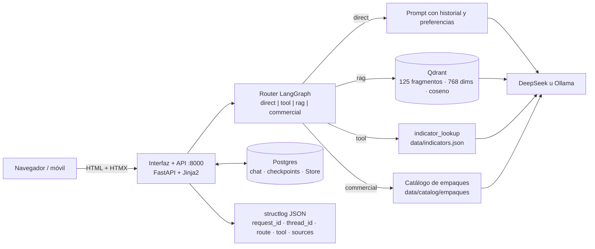
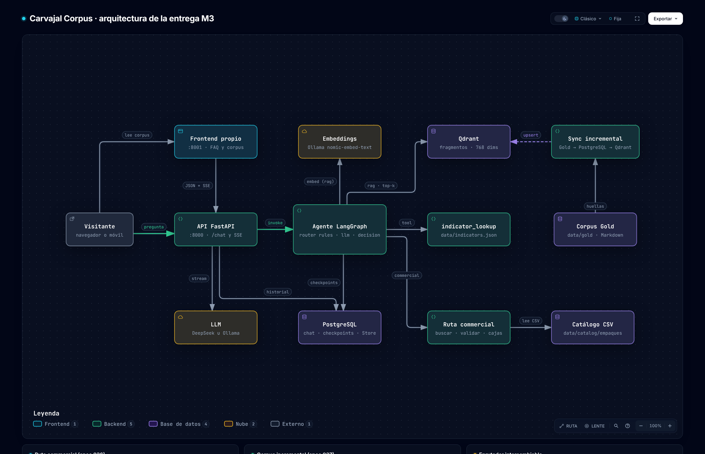
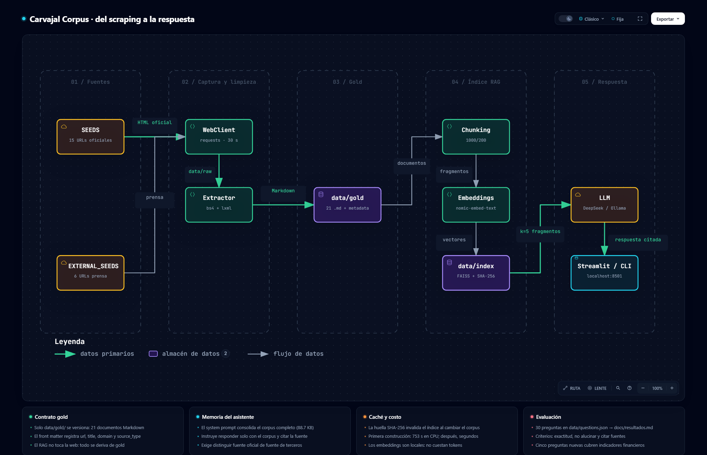

# Carvajal — Corpus Web

[](https://github.com/markodavid/carvajal/actions/workflows/ci.yml)
[](https://www.python.org/)
[](https://docs.astral.sh/uv/)
[](https://docs.astral.sh/ruff/)
[](LICENSE)

> Pipeline de captura y curaduría del corpus web de **Carvajal** para RAG.

## Descripción

Convertir las páginas públicas del sitio web de Carvajal en un corpus Markdown
citable, reproducible y listo para un pipeline de RAG, respetando `robots.txt` y
sin depender de una API del sitio.

## Problema y solución

**Problema.** Responder preguntas sobre una empresa exige un corpus fiable: los datos
están dispersos en el sitio corporativo, algunos indicadores solo se publican en PDFs o
detrás de contadores JavaScript, y cualquier modelo sin contexto inventa cifras.

**Solución.** Un pipeline reproducible que captura el sitio oficial y fuentes de prensa,
los normaliza en tres capas (bronze → silver → gold), los indexa con embeddings locales
y responde con un LLM **citando la fuente y distinguiendo** lo oficial de lo publicado por
terceros. Todo se demuestra en una interfaz única: el chat con fuentes citadas, la FAQ
generada, el explorador del corpus y la carga o captura de documentos.

| Antes | Después |
|---|---|
| Corpus de 2.45 MB con menús duplicados | **64.5 KB** de texto editorial tras corregir el extractor |
| Sin indicadores financieros (solo PDFs/JS) | **24 documentos** con ingresos, EBITDA, márgenes y empleo |
| Respuestas sin trazabilidad | Cada respuesta **cita medio, fecha y tipo de fuente** |
| Arranque de la app en ~5 min (embeddings) | **Segundos**, con índice persistido e invalidación por hash |

## Entrega M2 — agente con Qdrant, memoria y herramienta

La entrada oficial del Módulo 2 es **una sola interfaz** en
<http://localhost:8000>: el shell Jinja2/HTMX que la API sirve en el mismo
proceso. La API concentra credenciales, modelo, ruta, memoria y herramientas.



### Arranque reproducible

Dos caminos equivalentes. El primero necesita `uv` y Ollama en el host; el
segundo solo Docker.

**Todo en Docker** (recomendado para clonar el repo en otra máquina):

```bash
cp .env.example .env                 # opcional; sin él se usa Ollama local
make up                              # app + Postgres + Qdrant + Ollama + corpus
                                     # http://localhost:8000  ← entrada única
make down                            # lo detiene conservando los volúmenes
```

> Si copias `.env.example`, cambia `LLM_PROVIDER` a `ollama` o completa
> `DEEPSEEK_API_KEY`. `make up` ya descarga `nomic-embed-text` y el modelo de
> chat de Ollama, así que el stack responde sin claves externas.

`make up` activa el perfil `full` de `compose.yml`: construye la imagen de
desarrollo, descarga `nomic-embed-text` y el modelo de chat de Ollama, aplica
migraciones, importa `data/gold` a Postgres e indexa en Qdrant antes de arrancar
la app (recarga en caliente y `./data` montado). Sin el perfil, `make db` y
`make qdrant` siguen levantando solo la infraestructura.

**Con el host** (`uv` + Ollama instalados):

```bash
# Preparación única
uv sync --all-extras
cp .env.example .env                 # completa DEEPSEEK_API_KEY y SESSION_SECRET
make db                              # Postgres 16 + pgvector
make qdrant                          # Qdrant con volumen persistente
uv run alembic upgrade head          # migraciones, incluida 0005
ollama pull nomic-embed-text         # embeddings locales de 768 dimensiones
uv run carvajal migrate-gold         # importa documentos y fragmentos a Postgres
make index                           # indexa data/gold en Qdrant (idempotente)

# Arranque: interfaz y API en el mismo proceso
make api                             # http://localhost:8000  ← entrada única
```

`make index` reejecuta la indexación con IDs UUID5 estables y poda los puntos
obsoletos; `uv run carvajal index-qdrant --recreate` reconstruye la colección
desde cero. El arranque web no indexa: funciona con un índice ya preparado.
`/live` comprueba el proceso y `/health` publica documentos, fragmentos y estado
de Qdrant por separado.

### Contrato del turno

`POST /api/chat/stream` acepta `question`, `csrf_token`, `client_turn_id` y
`thread_id` opcional. Emite SSE con estos eventos:

| Evento | Contenido |
|---|---|
| `open` | Apertura del stream. |
| `trace` | `thread_id`, `route` (`direct`/`tool`/`rag`/`commercial`), `intent`, `tool`, `memory`, `retrieved`. |
| `meta` | `sources[]` con `chunk_id`, `slug`, `title`, `url`, `source_type`, `score` y extracto. |
| `products` | Solo en la ruta `commercial`: `html` con las tarjetas de `_productos.html`, renderizadas y escapadas en la API. |
| `token` | Fragmento incremental de la respuesta. |
| `fallback` | Respuesta completa si el stream falla antes del primer token. |
| `done` | `conversation_id`, `message_id`, `thread_id`, `route`, `elapsed_ms`, `request_id`. |
| `error` | Mensaje accionable e `incomplete`; un 4xx/5xx SSE no se reintenta solo. |

El mismo contrato existe en el shell Jinja2 (`/chat/stream`) para compatibilidad,
y `GET /api/chat/history` devuelve el hilo activo al recargar.

### Memoria, herramienta y router

- **Corto plazo:** `PostgresSaver` con `thread_id = conversations.id`, verificado
  contra el dueño de la cookie. El historial de Postgres siembra el estado si el
  checkpoint no existe; un reinicio del backend recupera el mismo hilo.
- **Largo plazo:** `PostgresStore` en el namespace `("carvajal", "preferences",
  owner_key)`. Una preferencia declarada se recupera en otro hilo del mismo
  dueño y no cruza a otro visitante.
- **Herramienta:** el nodo `tool` invoca `indicator_lookup` con `@tool` y
  `args_schema` Pydantic sobre `data/indicators.json`. Devuelve valor, unidad,
  cita y URL, o una ausencia explícita.
- **Router:** orden documentado en `carvajal/agent/router.py`: preferencia →
  solicitud comercial de empaques → herramienta con período explícito →
  saludo/capacidad → RAG (seguimiento elíptico reescrito con la pregunta
  anterior) → abstención si falta evidencia. Los saludos no tocan Qdrant ni la
  herramienta. El enrutador es intercambiable (`AGENT_ROUTER=rules|llm|decision`,
  por defecto `rules`) y cada turno registra `agent.route_decided`.

La expansión de consulta usa fechas y entidades que el corpus ya declara
(`1904 Cali Colombia`, `10 países`, `13.000 empleados`) y las fichas de
`data/retrieval_cards.json` solo ayudan a recuperar; la cita siempre sale del
fragmento original.

### Evaluación

`data/eval/retrieval_questions.json` contiene 31 consultas etiquetadas a mano
(30 con evidencia y una sin evidencia). El reporte reproducible está en
[`docs/eval/retrieval-report.md`](docs/eval/retrieval-report.md). El JSON
completo con los 10 resultados por consulta se regenera con el mismo comando y
no se versiona para no inflar el PR.

```bash
make index-eval     # indexa y ejecuta scripts/eval_retrieval.py
```

Resultado de la última corrida (Qdrant, k=10): **Recall@10 = 0.8000**,
**nDCG@10 = 0.7791**; la consulta sin evidencia (`q31`, teléfono en Tokio) se
abstiene sin fuentes. La evaluación separa retrieval de calidad de respuesta:
no llama al LLM.

## Entrega M3 — asistente de empaques y corpus incremental

La tercera entrega extiende el agente del M2 sin cambiar su contrato: el router suma la ruta
`commercial` para recomendar y cotizar empaques de Carvajal Empaques (spec 036), el enrutador
se vuelve intercambiable y medible, y el corpus pasa a sincronizarse de forma incremental entre
Gold, PostgreSQL y Qdrant (spec 037).

[](docs/arquitectura-m3.html)

Diagrama interactivo generado con [Archify](https://github.com/tt-a1i/archify) 3.2:
[`docs/arquitectura-m3.html`](docs/arquitectura-m3.html) (pan/zoom, búsqueda, rutas, tema
claro/oscuro y exportación). La fuente versionada es
[`docs/arquitectura-m3.json`](docs/arquitectura-m3.json): cada componente cita el archivo y las
líneas del código que lo respaldan en el commit `a369705` de `dev`, y Archify verifica esas
citas al generar el HTML.

| Novedad | Qué hace | Dónde |
|---|---|---|
| Ruta `commercial` | Extrae uso, temperatura, capacidad, cantidad, país y ciudad; valida el material con la guía; calcula cajas y precio de referencia (México) o remite a distribuidores (Colombia). El LLM solo redacta. | [Catálogo de empaques](#catálogo-de-empaques-spec-036) |
| Tarjetas en el chat | Cada referencia llega como tarjeta por el evento SSE `products`, con SKU, cajas, precio con fecha y enlace a la ficha. | `apps/api/templates/_productos.html` |
| Enrutador intercambiable | `AGENT_ROUTER=rules` (por defecto), `llm` o `decision`; `carvajal eval-router` los compara sobre 110 preguntas. | [`docs/resultados-router.md`](docs/resultados-router.md) |
| Corpus incremental | Solo importa e indexa lo nuevo o cambiado, por huella; `--verify` compara sin escribir. | [Corpus incremental](#corpus-incremental-spec-037) |

```bash
uv run carvajal sync --layer all          # Gold → PostgreSQL → Qdrant, incremental
uv run carvajal sync --verify             # compara huellas y conteos sin escribir
uv run carvajal eval-router               # precisión del enrutador por reglas
```

Para probarlo, levanta el entorno como en el M2 y abre el chat en
<http://localhost:8000/chat>; el guion de la demo está en [`docs/demo-036.md`](docs/demo-036.md)
y la evidencia de los criterios de éxito en
[`specs/036-asistente-empaques/evidencia.md`](specs/036-asistente-empaques/evidencia.md).

## Stack

| Categoría | Tecnología |
|-----------|------------|
| **Lenguaje** | Python 3.13+ |
| **Gestor de paquetes y entorno** | [`uv`](https://docs.astral.sh/uv/) |
| **Build backend** | `uv_build` (src-layout) |
| **Paquete Python** | `carvajal` |
| **HTTP** | `requests` (sesión única, `User-Agent` identificable, `timeout`) |
| **Parseo HTML** | `beautifulsoup4` + `lxml` |
| **RAG web (M2)** | Qdrant + LangGraph + Postgres (checkpointer y Store) |
| **RAG legado** | LangChain + FAISS |
| **LLM** | DeepSeek (`deepseek-chat`), Anthropic Claude u Ollama (`llama3.2`) |
| **Interfaz de pruebas** | HTMLX |
| **Tipado estático** | [`ty`](https://github.com/astral-sh/ty) |
| **Testing** | [`pytest`](https://docs.pytest.org/) |
| **Linting / Formato** | [Ruff](https://docs.astral.sh/ruff/) |
| **Pre-commit** | [pre-commit](https://pre-commit.com) |
| **CI/CD** | [GitHub Actions](.github/workflows/ci.yml) |
| **Dependencias automáticas** | [Dependabot](.github/dependabot.yml) |

## Fuentes del corpus

| Origen | Dominio | Aporte |
|---|---|---|---|
| Sitio oficial | `carvajal.com` | Misión, historia, sectores, gobierno corporativo, sostenibilidad |
| Prensa económica | `larepublica.co`, `elpais.com.co`, `caliescribe.com` | Ingresos, EBITDA, márgenes, utilidad neta, activos, pasivos, patrimonio, empleo |
| Corpus extendido (colaborativo) | `carvajalempaques.com`, `carvajaleducacion.com`, `mepal.com.co`, `cencarvajal.co`, fundaciones… | Productos, políticas, sedes y páginas de las filiales que el sitio matriz no cubre |

Los documentos de terceros se marcan en el *front matter* con `source_type: tercero`, los
del corpus extendido con `source_type: colaborador`, y el asistente está instruido para
atribuir cada cifra a su medio y fecha.

## Pipeline de captura

```text
semillas (24 URLs)
   │  robots.txt + rate limit (1 s/host) + User-Agent propio + timeout 30 s
   ▼
Bronze  data/raw/*.html          HTML crudo, tal como llegó
   ▼
Silver  data/processed/*.md      Markdown limpio (sin menús, header ni footer)
   ▼
Gold    data/gold/*.md           Markdown + front matter (url, title, section,
                                 domain, source_type, captured_at, hash, chars)
   ▼
Índice  data/gold/index.jsonl    una línea por documento (URL, sección, hash, tokens)
```

- **Deduplicación** por huella SHA-256 del contenido; las páginas casi vacías
  (< 200 caracteres) no se deduplican para no perder secciones distintas.
- **Enriquecimiento**: `section` se deriva de la URL del sitio oficial (`inversionistas`,
  `quienes-somos`…) y es `prensa` en las fuentes de terceros; `hash` y `chars` describen
  cada documento.
- **Métricas**: al terminar, `carvajal capture` reporta descubiertas, descargadas,
  escritas, descartadas (robots, duplicadas, errores), caracteres, tokens estimados y
  duración.

## Corpus extendido (capa de recuperación)

El núcleo (`data/gold/`) es el corpus curado que se consolida en el prompt. Encima se
importa un **corpus externo** que solo participa en la recuperación: no se copia al
prompt, se cita por fragmento con su URL y su categoría.

```bash
make import
# o: uv run carvajal import
```

La ruta del donante se configura con `EXTERNAL_CORPUS_DIR` (por defecto
`../proyecto-carvajal`). La importación usa categorías y presupuesto fijos de
`config.py`, re-extrae el HTML Bronze con el extractor propio y **no importa PDF**;
si el HTML no deja texto suficiente, usa el Silver del donante como respaldo.

| Aspecto | Núcleo | Capa extendida |
|---|---|---|
| Ruta | `data/gold/*.md` | `data/external/<fuente>/gold/*.md` |
| Prompt | Sí, completo | No, solo fragmentos recuperados |
| Procedencia | `source_type: oficial\|tercero` | `source_type: colaborador`, `origin`, `category`, `entity` |
| Versionado en Git | Sí | No: se regenera con `carvajal import` (solo se versiona el manifiesto) |
| Selección | Semillas de `config.py` | Categorías fijas de `EXTERNAL_CATEGORIES` |

La importación es idempotente: reconstruye la salida desde cero, descarta las URLs que
ya están en el núcleo y deduplica por URL normalizada y hash del texto. Escribe
`manifest.json` con la fuente, la captura donante y los conteos por categoría.

> La capa extendida es material de terceros: conserva la atribución y no se presenta como
> comunicación oficial de Carvajal.

## Corpus incremental (spec 037)

Todo lo que entra al corpus pasa por el mismo camino: identidad estable, deduplicación
por huellas, capas Bronze/Silver/Gold y una única sincronización con PostgreSQL y
Qdrant.

**Identidad.** Cada documento se identifica por su fuente, nunca por su texto:
`url:<normalizada>` para capturas, `file:<raíz>/<ruta relativa>` para carpetas de la
consola y `upload:<nombre>` para subidas web. El slug se asigna una vez y no se
renombra. Un archivo movido conserva la identidad anterior y se reporta como duplicado.

**Deduplicación.** Antes de escribir Bronze se compara el `raw_hash` (SHA-256 de los
bytes): una copia exacta o un archivo movido no se procesa. Tras extraer se recalcula
el `content_hash` del texto: una página con otro HTML pero el mismo texto, o un PDF
re-codificado, se reporta con el documento existente sin reindexar. El informe separa
nuevos, actualizados, idénticos y duplicados.

**Sincronización.** `carvajal sync` es el único camino entre Gold y los almacenes:

```bash
uv run carvajal sync --layer all          # núcleo + cada fuente extendida
uv run carvajal sync --layer all --prune  # además elimina lo que ya no está en Gold
uv run carvajal sync --layer all --verify # no escribe; sale con 1 si hay diferencias
uv run carvajal sync --adopt              # completa source_key/raw_hash en un registro legado
```

La corrida es incremental: compara huellas y solo importa e indexa lo nuevo o cambiado;
la poda se limita a la capa sincronizada. La captura web y la carga desde Configuración
terminan en la misma sincronización y comparten `data/.corpus.lock`, así que dos
corridas no dejan el corpus a medio escribir.

**Prioridad de capas.** El chat busca primero `layer=core` y solo completa con
`layer=extended` si el núcleo no llena el cupo o queda por debajo de `RAG_MIN_SCORE`. La
cita conserva `origin`, `category` y `entity` del front matter extendido. La FAQ sigue
leyendo solo el núcleo, y `make index-eval` mide la misma política con
`carvajal index-qdrant --layer all`.

## Catálogo de empaques (spec 036)

El asistente comercial de empaques consulta un **catálogo curado** en `data/catalog/empaques/`
(CSV versionados y `manifest.json`), no el RAG: recomendar un vaso exige filtros exactos de
capacidad, material y temperatura.

| Archivo | Contenido | Cómo se mantiene |
|---|---|---|
| `referencias.csv` | Referencias con SKU, material, unidades por caja, temperatura de uso y precio de referencia (México) | `carvajal catalog-build` para México; otros países curados a mano |
| `materiales.csv` | Reglas de la guía de materiales (PP, EPS, PS, PET, aluminio) | Curado a mano |
| `distribuidores.csv` | Distribuidores de Colombia por ciudad (sin datos personales) | Curado a mano |

```bash
uv run carvajal catalog-build --corpus <carpeta del corpus externo> --captured-at 2026-10-23
```

La orden lee las fichas HTML de la tienda de Carvajal Empaques México, regenera sus filas,
conserva las de otros países y anota en el manifiesto las fichas descartadas o
contradictorias. Los precios son siempre de referencia y llevan la fecha de captura. Si el
corpus no incluye una ficha que ya estaba en `referencias.csv`, la orden aborta antes de
escribir para no perder filas; `--allow-missing` acepta la baja.

### Ruta `commercial` del agente

Una pregunta que nombra un producto (vaso, tapa, contenedor, charola, cubierto, envase,
plato) con intención de compra o datos de la necesidad va a la ruta `commercial`. El
router extrae uso, temperatura, microondas, capacidad (ml → oz), cantidad, país y ciudad;
si falta la temperatura, pide aclararla. El nodo ejecuta una secuencia fija y determinista
(`agent/commercial_flow.py`): buscar → validar el material con la guía → cajas y precio de
referencia (solo México) → canal de compra (tienda en México, distribuidores por ciudad en
Colombia). El LLM solo redacta con ese resultado, y el chat muestra una tarjeta por
referencia con SKU, material, cajas, precio con fecha y enlace a la ficha.

| Pregunta | Ruta |
|---|---|
| «Necesito 5.000 vasos de 12 oz para café en México» | `commercial`: 5 cajas por referencia, total en MXN con aviso |
| «busco vasos de 16 oz» | `direct`: pide si el contenido es caliente o frío |
| «vasos para jugo en Medellín» | `commercial`: sin precio, distribuidores de Medellín |
| «quiero vasos personalizados con mi logo» | `commercial`: se deriva a los canales oficiales, sin recomendar |
| «¿Qué vasos fabrica Carvajal Empaques?» | `rag`: pregunta institucional |

```bash
uv run carvajal eval-router                              # 110 preguntas, enrutador por reglas
uv run carvajal eval-router --router rules --router llm  # comparación con el LLM
```

Resultados y análisis: [`docs/resultados-router.md`](docs/resultados-router.md).

## 🗺️ Arquitectura

La arquitectura vigente, con el agente, la ruta `commercial` y la sincronización incremental,
está en la [entrega M3](#entrega-m3--asistente-de-empaques-y-corpus-incremental). El diagrama de
esta sección es el de la primera entrega: el pipeline de captura y el RAG original.

Diagrama interactivo autocontenido (generado con [Archify](https://github.com/tt-a1i/archify)):
pan/zoom, búsqueda de componentes, tema claro/oscuro y exportación. Ábrelo en el
navegador: [`docs/arquitectura.html`](docs/arquitectura.html). La fuente tipada y
versionada es [`docs/arquitectura.json`](docs/arquitectura.json), y la versión Mermaid
está en [`docs/arquitectura.md`](docs/arquitectura.md).

[](docs/arquitectura.html)

## Instalación

```bash
# Clonar el repositorio
git clone git@github.com:markodavid/carvajal.git
cd carvajal

# Sincronizar el entorno (crea .venv e instala dependencias)
uv sync --all-extras
```

> `--all-extras` instala también los extras `capture` (HTTP y extracción HTML
> para la CLI) y `legacy` (FAISS para la CLI histórica). La app web y su imagen
> Docker solo necesitan las dependencias base.

## Uso

> El CLI (`carvajal capture`, `sync`, `index-qdrant`, `status`, `ask`, `eval`,
> `summarize`, `faq`, `import`, `migrate-gold`) requiere los extras de captura y
> prototipo:
> `uv sync --all-extras` en el repositorio, o
> `uv tool install "carvajal[capture,legacy]"` fuera de él. La imagen Docker
> solo instala el runtime web y no incluye el CLI.

```bash
# Capturar el sitio oficial y las fuentes de terceros
# (descubrir → extraer → limpiar → deduplicar → enriquecer)
uv run carvajal capture

# Solo el sitio oficial / solo fuentes de terceros
uv run carvajal capture --scope oficial
uv run carvajal capture --scope terceros

# Ajustar el rate limit o ignorar robots.txt (solo pruebas locales)
uv run carvajal capture --delay 2.0
uv run carvajal capture --ignore-robots

# Ver el estado del corpus (documentos, origen, tokens, índice)
uv run carvajal status

# Listar semillas
uv run carvajal list

# Preguntar al corpus (RAG)
uv run carvajal ask "¿En qué consiste el fondo de inversión de Carvajal?"

# Tareas de LLM sobre el corpus completo
uv run carvajal summarize            # resumen ejecutivo -> docs/resumen.md
uv run carvajal summarize --focus empaques
uv run carvajal faq                  # FAQ de cliente -> docs/faq.md

# Interfaz web única: chat, FAQ, corpus y configuración
make api                        # http://localhost:8000/chat

# Evaluación: 25 preguntas de prueba -> docs/resultados.md
make eval
```

### Interfaz web del M2

La entrada oficial del Módulo 2 es <http://localhost:8000> (`make api`): un
único proceso sirve el shell Jinja2/HTMX y la API. La navegación superior
ofrece **Chat**, **FAQ**, **Corpus** y **Configuración**, más la ficha
`/documents/{id}`; `/` redirige a `/chat`.
Corpus y Documento leen los endpoints JSON `/api/corpus` y
`/api/documents/*`, que reutilizan los mismos proveedores y el saneamiento
`nh3` de las vistas HTML. El chat emite SSE por `/chat/stream` (y conserva
`/api/chat/stream` como contrato JSON equivalente). El chat es el
**único camino de respuesta**: la ruta heredada `/ask` y el adaptador pgvector
se retiraron en la spec 037 porque ningún flujo escribía vectores en Postgres.
Su
pestaña **FAQ** (`/faq`) consume el mismo endpoint `/api/faq` y ofrece la misma
experiencia de lotes de 10. Sus pantallas comparten la cabecera, la paleta y los
componentes visuales del frontend del M2. El texto generado se formatea con Markdown saneado, las
fuentes se pliegan por defecto y cada cita abre un panel lateral con el
documento en el fragmento citado. El chat mantiene el compositor abajo, un
panel de hilos anteriores y la pestaña **Configuración** para subir documentos
o carpetas y para capturar páginas web por semillas o URLs: Bronze → Silver →
Gold → PostgreSQL → Qdrant, reutilizando el pipeline del corpus y conservando
los documentos ya indexados. La captura muestra el progreso por SSE, respeta
`robots.txt` y valida las URLs contra un guard SSRF; en esta fase la carga y la
captura son públicas y no exigen autenticación.

#### Carga local multiformato (web y consola)

La pestaña Configuración y la consola aceptan `.pdf`, `.xml`, `.json`, `.jsonl`,
`.csv`, `.tsv`, `.html`, `.txt`, `.md` y `.markdown`. Cada archivo deja el original en
Bronze, el texto extraído en Silver y la ficha en Gold; los PDF conservan el número de
página (`## Página N`) gracias a `pdftotext` (poppler-utils) y los escaneados se rechazan
con un aviso de OCR. Los datos estructurados se validan (sin DTD ni entidades externas)
y se conservan como texto íntegro delimitado por su formato. La web mantiene 100
archivos por carga y 5 MB por archivo.

Para volúmenes grandes, desde la consola:

```bash
python -m apps.api.ingest_cli /ruta/de/la/carpeta --source-type oficial
```

Recorre carpetas y subcarpetas, ignora las extensiones no admitidas, procesa en lotes
(`--lote`, 25 por defecto; `--max-batch-mb`, 256 MB por defecto), admite 100 MB por archivo
(`--max-file-mb`) y al cerrar cada lote actualiza PostgreSQL y Qdrant. Cada lote se lee de
disco al procesarlo, así que la memoria viva se acota al lote y no al tamaño del corpus.
`--solo-extraer` se detiene en Gold para revisar la
extracción antes de tocar la base y el índice. `--source-type` (`oficial`, `tercero` o
`colaborador`) fija la procedencia que se escribe en el *front matter*: la procedencia es
independiente de que el archivo se suba por la web o se importe por consola.

En el VPS se ejecuta dentro del contenedor, que es donde están la base, Qdrant y los
volúmenes:

```bash
cd /opt/carvajal
docker compose -f compose.prod.yml run --rm --no-deps \
  -v /opt/carvajal/inbox:/inbox:ro \
  app python -m apps.api.ingest_cli /inbox --source-type oficial
```

Los archivos de `/opt/carvajal/inbox` se leen en solo lectura; el original queda copiado
en el volumen (`appdata`) dentro de Bronze, así que la carpeta del host puede borrarse
después.

La pestaña **FAQ** genera hasta 10 preguntas frecuentes por lote con el corpus
núcleo completo y las agrupa por tema con su fuente. El botón **Generar otras
10** pide un lote nuevo, excluye las preguntas ya mostradas y acumula el
resultado en la pestaña; **Descargar faq.md** produce el Markdown equivalente.
La generación usa SSE, comparte el CSRF y la cuota diaria del chat y avisa
cuando el corpus se truncó por longitud. Con Ollama, la ventana de contexto se
configura con `OLLAMA_NUM_CTX` (32 768 tokens por defecto) para que el corpus
completo quepa en el prompt.

### Módulo 1 (histórico)

El prototipo Streamlit del Módulo 1 se retiró junto con la SPA duplicada: la
interfaz única es el shell Jinja2/HTMX en :8000. Las tareas del M1 siguen
disponibles por consola —`carvajal capture`, `summarize`, `faq`, `ask` y
`eval`— y las capturas del prototipo quedan como evidencia en `docs/ui-*.png`.

La identidad visual usa el **logo oficial en SVG** (`assets/carvajal-logo.svg`)
y la paleta de marca del sitio (`#00B5E5`, `#80A41B`, `#ED7004`, `#62358C`,
`#003A5D`, `#015625`), definida en `apps/api/static/app.css`.

## Configuración del LLM

Copia el archivo de ejemplo y completa tu clave (`.env` está en `.gitignore`):

```bash
cp .env.example .env
```

```ini
LLM_PROVIDER=deepseek
DEEPSEEK_API_KEY=sk-...
DEEPSEEK_MODEL=deepseek-chat
```

También puedes configurar las variables en la terminal:

| Variable | Descripción | Default |
|----------|-------------|---------|
| `LLM_PROVIDER` | Proveedor LLM: `ollama`, `deepseek` o `claude`. | `ollama` |
| `DEEPSEEK_API_KEY` | Clave API de DeepSeek (solo si `LLM_PROVIDER=deepseek`). | `""` |
| `DEEPSEEK_MODEL` | Modelo DeepSeek a utilizar. | `deepseek-chat` |
| `DEEPSEEK_BASE_URL` | Endpoint compatible con OpenAI. | `https://api.deepseek.com/v1` |
| `ANTHROPIC_API_KEY` | Clave API de Anthropic (solo si `LLM_PROVIDER=claude`). | `""` |
| `CLAUDE_MODEL` | Modelo Claude a utilizar (p. ej. `claude-sonnet-4-5`). | `claude-sonnet-4-5` |
| `OLLAMA_MODEL` | Modelo local para el chat y la FAQ. | `llama3.2` |
| `OLLAMA_NUM_CTX` | Ventana de contexto de Ollama; debe caber el prompt de la FAQ. | `32768` |
| `QDRANT_URL` | Endpoint de Qdrant. | `http://127.0.0.1:6333` |
| `QDRANT_COLLECTION` | Colección del índice M2. | `carvajal_chunks` |
| `QDRANT_DIMENSIONS` | Dimensión de los embeddings. | `768` |
| `RAG_TOP_K` | Fragmentos que recibe el prompt. | `6` |
| `RAG_MIN_SCORE` | Umbral mínimo de similitud. | `0.30` |
| `AGENT_CHECKPOINTER` | `postgres` o `sqlite` para la demo local. | `postgres` |
| `CAPTURE_DEFAULT_URLS` | Valor inicial del máximo de URLs por captura. | `5` |
| `CAPTURE_MAX_BYTES` | Tamaño máximo de una respuesta capturada. | `5000000` |
| `CAPTURE_TIMEOUT_SECONDS` | Timeout por petición de la captura. | `30` |
| `CAPTURE_MAX_REDIRECTS` | Saltos de redirección permitidos y revalidados. | `5` |
| `CAPTURE_REQUESTS_LIMIT` | Capturas por IP y ventana; `0` desactiva el límite. | `5` |
| `CAPTURE_WINDOW_SECONDS` | Ventana en segundos del límite por IP. | `3600` |
| `CAPTURE_ALLOWED_DOMAINS` | Allowlist opcional separada por coma; vacía = cualquier host público. | vacío |
| `CAPTURE_ALLOW_PRIVATE_HOSTS` | Solo desarrollo: permite loopback y redes privadas. | `false` |

> Los embeddings se calculan localmente con Ollama (`nomic-embed-text`),
> independientemente del proveedor del LLM. `make index` requiere ese modelo.

Para la app web, `SESSION_SECRET` firma la cookie anónima. En producción es
obligatorio (`compose.prod.yml` falla si falta). En desarrollo, fíjalo también
si vas a reiniciar el backend durante la demo: con un secreto aleatorio por
proceso, la cookie deja de validar y el hilo no se recupera. El shell genera
además un hash de 256 bits en `localStorage` la primera vez que visita cada
navegador, lo refleja en la cookie `carvajal_visitante` y el servidor deriva el
dueño con HMAC; así recupera sus hilos aunque se pierda la cookie firmada. No
es autenticación: el hash es un identificador anónimo portador.
`DAILY_REQUESTS_LIMIT` y `QUOTA_TIMEZONE` configuran la cuota diaria;
`POSTGRES_*`/`DATABASE_URL` configuran la base.

El índice vectorial FAISS se guarda en `data/index/` (ignorado por Git) y se reutiliza
mientras el corpus no cambie, de modo que la app arranca en segundos. La primera
ejecución calcula los embeddings desde cero (varios minutos en CPU). Para forzar el
recálculo, borra `data/index/`.

Ejemplo con DeepSeek vía API:

```bash
$env:LLM_PROVIDER = "deepseek"
$env:DEEPSEEK_API_KEY = "<tu-clave-de-deepseek>"
$env:DEEPSEEK_MODEL = "deepseek-chat"
uv run carvajal ask "¿Cuál es la misión de Carvajal?"
```

## Calidad

```bash
make install    # uv sync --all-extras
make dev        # install + pre-commit install
make check      # lint + formato + tipos + pruebas
make lint       # Ruff (lint)
make format     # Ruff (formato)
make typecheck  # ty
make test       # pytest
make build      # uv build
make image      # imagen Docker de la app web
make up         # stack completo en Docker: app + base + Qdrant + Ollama + corpus
make down       # detiene el stack completo (conserva los volúmenes)
make prod-up    # app + base + Qdrant + Ollama en APP_PORT (requiere SESSION_SECRET)
make prod-down  # detiene los servicios (conserva los volúmenes)
make prod-bootstrap  # servidor limpio: modelos, migraciones, Postgres y Qdrant
make db         # Postgres 16 con pgvector (docker compose)
make db-down    # detiene la base local
make clean      # limpiar cachés y artefactos
```

## Imagen Docker

```bash
make image                  # docker build -t carvajal-api:local .
export SESSION_SECRET="$(python -c 'import secrets; print(secrets.token_urlsafe(32))')"
export APP_PORT=8080        # puerto público de la demo
make prod-up                # app + Postgres + Qdrant + Ollama
make prod-bootstrap         # modelos, migraciones, corpus e índice (una vez)
```

La imagen es multi-etapa, corre con un usuario sin privilegios y solo instala
las dependencias del runtime web; los extras `capture` y `legacy` se quedan
fuera. El build fija las imágenes base por digest y omite `zstandard`
(compresión opcional de trazas de LangSmith) y las herramientas de build (`uv`,
`pip`) para mantenerse por debajo de 300 MB. `compose.prod.yml` exige
`SESSION_SECRET` (falla si falta) y endurece el contenedor con `read_only`,
`cap_drop: ALL` y `no-new-privileges`.

En producción el despliegue es automático al fusionar el PR de release en
`main`: GitHub Actions publica la imagen en GHCR con un tag `sha-<commit>` y
`scripts/deploy.sh` la descarga en el VPS, aplica migraciones y comprueba
`/live` y `/health`. La demo se publica directamente en `http://IP:APP_PORT`
(8080 por defecto), sin dominio ni TLS. El runbook —VPS, secretos, primer
despliegue, respaldos y rollback— está en
[`docs/despliegue-ovh.md`](docs/despliegue-ovh.md).

| Ruta | Qué comprueba | Depende de Postgres |
|---|---|---|
| `GET /live` | Que el proceso responde (liveness del contenedor). | No |
| `GET /health` | Conteos de documentos/fragmentos, estado de Qdrant y bloque `monitoring` (readiness). | Sí |
| `GET /api/health` | El mismo readiness en JSON para clientes automatizados. | Sí |

### Monitoreo con LangSmith (opcional)

El agente puede enviar una traza por turno a [LangSmith](https://smith.langchain.com).
Está **apagado por defecto**: sin `MONITORING_ENABLED=true` y sin llave no se
construye cliente ni sale un solo byte del proceso, y las pruebas no piden
credenciales ni tocan la red.

| Variable | Por defecto | Qué hace |
|---|---|---|
| `MONITORING_ENABLED` | `false` | Enciende el monitoreo. Sin esto no hay traza. |
| `LANGSMITH_API_KEY` | vacío | Obligatoria si se enciende; nunca se registra en logs ni en `/health`. |
| `LANGSMITH_PROJECT` | `carvajal` | Proyecto de LangSmith. |
| `LANGSMITH_ENDPOINT` | vacío | Solo para un servicio compatible o pruebas. |
| `MONITORING_SAMPLE_RATE` | `0.2` | Fracción de turnos trazados (0..1); `0` equivale a apagado. |
| `MONITORING_INCLUDE_CONTENT` | `false` | `true` solo en desarrollo y evaluación. |
| `MONITORING_TIMEOUT_MS` | `2000` | Timeout del cliente; no bloquea el turno. |

- **Producción solo con metadatos** (`MONITORING_INCLUDE_CONTENT=false`): la traza
  lleva ruta, enrutador, pasos, tokens, latencias, `slug`/`chunk_id`/`score` y el
  tipo de error, pero **no** el texto de preguntas, respuestas ni fragmentos.
  En desarrollo y en las corridas de evaluación se envía el contenido completo.
- `/health` publica `monitoring: {enabled, sample_rate, content}` sin llave ni
  endpoint. El arranque fuerza `LANGSMITH_TRACING` y `LANGCHAIN_TRACING_V2` a
  `false` para que una variable heredada no encienda el tracing global.
- **Presupuesto**: el plan gratuito cubre 5.000 trazas al mes; con muestreo del
  20 % son hasta 25.000 turnos. Si el uso se acerca a 4.000, baja el muestreo a
  `0.1` o apaga `MONITORING_ENABLED`.
- **Buscar un turno**: por el `request_id` que devuelve el evento `done` y los
  logs JSON, o por hilo con `thread_hash`, los primeros 16 caracteres hex del
  SHA-256 del identificador de la conversación:
  `python -c "import hashlib;print(hashlib.sha256(b'<thread_id>').hexdigest()[:16])"`.
- **Si el servicio falla** (caído, lento o sin cuota), el chat responde, persiste
  y cobra la cuota igual; el fallo queda en los logs como `monitoring.failed`.

La operación (plan, apagado, comparación de experimentos) está en
[`docs/monitoreo-langsmith.md`](docs/monitoreo-langsmith.md).

La demo no lleva proxy TLS: la app se publica en `0.0.0.0:APP_PORT` (8080 por
defecto) y se accede por `http://IP:8080`. Si más adelante pones un dominio, usa
nginx/Caddy delante, publica la app solo en `127.0.0.1:8000` y ajusta
`FORWARDED_ALLOW_IPS` a la IP del proxy. De ello dependen las cookies `Secure`,
HSTS y la cabecera CSRF cuando hay TLS.

## Estructura

```text
carvajal/
├── apps/
│   └── api/        # FastAPI, contrato HTTP/SSE, shell Jinja2/HTMX e interfaz única
├── packages/core/src/carvajal/
│   ├── agent/      # router, herramienta, memoria y grafo LangGraph
│   ├── indexing/   # Gold → Qdrant
│   └── adapters/   # storage, embeddings, LLM y vector (Qdrant)
├── tests/
├── data/
│   ├── gold/       # entregable versionado (capa gold)
│   ├── eval/       # consultas etiquetadas del retrieval
│   ├── indicators.json      # herramienta del M2
│   └── retrieval_cards.json # fichas de recuperación
│                   # data/external/ se genera con `carvajal import` (ignorado)
│                   # data/index/ es la caché FAISS legada (ignorada)
├── docs/
├── .github/
├── .opencode/
├── AGENTS.md
├── CONSTITUTION.md
├── README.md
├── CONTRIBUTING.md
├── CODE_OF_CONDUCT.md
├── Makefile
├── Dockerfile          # imagen multi-etapa de la app web (W6.1)
├── compose.yml         # Postgres local de desarrollo
├── compose.prod.yml    # app + Postgres para una sola máquina
├── pyproject.toml
├── uv.lock
├── .python-version
└── .pre-commit-config.yaml
```

## Documentación

- [`specs/`](specs/) — especificaciones versionadas con Spec Kit: `spec`, `plan` y `tasks` por funcionalidad. El índice, la convención *as-built* y el orden de escritura están en [`specs/README.md`](specs/README.md).
- [`docs/prompts.md`](docs/prompts.md) - los tres prompts, las variantes probadas y qué se decidió.
- [`docs/alcance.md`](docs/alcance.md) — alcance del Q&A: tipos de pregunta y cobertura real del corpus.
- [`docs/arquitectura.md`](docs/arquitectura.md) — diagramas Mermaid del pipeline y del stack.
- [`docs/arquitectura.html`](docs/arquitectura.html) — diagrama interactivo (Archify), fuente en `docs/arquitectura.json`.
- [`docs/informe.md`](docs/informe.md) — informe del proyecto (problema, solución, datos, modelado, resultados).
- [`docs/presentacion.md`](docs/presentacion.md) — guion de la sustentación (15 min, sin PowerPoint).
- [`CONSTITUTION.md`](CONSTITUTION.md) — verdad central del proyecto.

## Contribución

Lee [`CONTRIBUTING.md`](CONTRIBUTING.md) y la [`CONSTITUTION.md`](CONSTITUTION.md).

## Créditos

- **Autor:** Marko David García — proyecto del curso *Taller de Aplicaciones de IA y
  Machine Learning* (UAO).
- **Corpus:** contenido público de [carvajal.com](https://www.carvajal.com), citado con su
  URL y fecha de captura. Las cifras financieras provienen de
  [La República](https://www.larepublica.co), [El País](https://www.elpais.com.co) y
  [Caliescribe](https://caliescribe.com), y se atribuyen en cada respuesta.
- **Herramientas:** [uv](https://docs.astral.sh/uv/), [Ruff](https://docs.astral.sh/ruff/),
  [ty](https://github.com/astral-sh/ty), [LangChain](https://www.langchain.com/),
  [FAISS](https://github.com/facebookresearch/faiss),
  [Ollama](https://ollama.com/),
  [DeepSeek](https://www.deepseek.com/) y [Archify](https://github.com/tt-a1i/archify).

## Licencia

Distribuido bajo la licencia [MIT](LICENSE).
