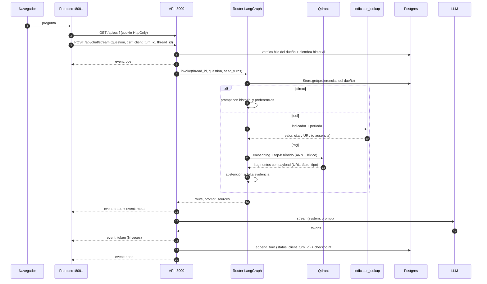

# Arquitectura del M2 — agente, Qdrant y memoria

> Entrada oficial: **http://localhost:8001** (`make web`). API:
> **http://localhost:8000** (`make api`). Postgres conserva chat, checkpoints y
> preferencias; Qdrant es el índice vectorial evaluado.

## Flujo de un turno

## Componentes

| Componente | Responsabilidad | Archivo |
|---|---|---|
| Frontend propio | Shell SPA con pestañas Asistente · Corpus · Documento, streaming, errores y citas clicables | `apps/web/` |
| Contrato HTTP/SSE | JSON de historial, CSRF, nuevo hilo, stream y lectura de corpus/documentos | `apps/api/views/api.py`, `apps/api/views/stream.py` |
| Lectura del corpus | Búsqueda/filtros paginados y ficha de documento con HTML saneado | `apps/api/views/corpus.py`, `apps/api/views/documents.py` |
| Servicio de chat | hilo, idempotencia, persistencia, estado incompleto | `apps/api/chat/service.py` |
| Grafo | router, memoria, herramienta y preparación del prompt | `packages/core/src/carvajal/agent/` |
| Checkpointer | `PostgresSaver` por `thread_id` | `apps/api/agent_runtime.py` |
| Store | `PostgresStore`, namespace por dueño | `apps/api/agent_runtime.py` |
| Índice | IDs UUID5, upsert idempotente, poda y payload | `packages/core/src/carvajal/adapters/vector/qdrant_store.py` |
| Indexador | Gold → chunks → embeddings → Qdrant | `packages/core/src/carvajal/indexing/qdrant.py` |
| Herramienta | indicadores verificables por nombre y período | `packages/core/src/carvajal/agent/tools.py` |
| Observabilidad | JSON con `request_id`, `thread_id`, ruta, tool, fuentes y duración | `apps/api/observability.py`, `chat/service.py` |

## Pantallas de lectura

El shell de `apps/web` sirve la misma SPA en `/`, `/corpus` y
`/documents/{id}`. El navegador conserva el hilo y el stream del chat al cambiar
de pestaña; las vistas de lectura consumen JSON y no acceden a Postgres.

| Endpoint | Uso |
|---|---|
| `GET /api/corpus` | Lista paginada con `q`, `section`, `source_type`, `layer`, `page` y `page_size`; `total` y `has_next` se calculan sobre el conjunto filtrado. |
| `GET /api/documents/{id}` | Ficha, HTML saneado con `nh3`, hash, fecha de captura y versiones. |
| `GET /api/documents/by-slug/{slug}` | Resuelve una cita del chat por el slug real del documento. |

Las rutas HTML `/corpus` y `/documents/{id}` de la API se mantienen como
compatibilidad y comparten los mismos proveedores.

## Decisiones verificables

1. **Qdrant es el RAG evaluado.** `PgVectorStore` sigue existiendo para el
   prototipo y las pruebas históricas, pero el chat web usa
   `QdrantVectorStore`.
2. **Postgres sigue siendo fuente de verdad relacional.** Documentos, chat y
   memoria viven ahí; Qdrant es derivado y reconstruible.
3. **El índice se prepara antes del arranque.** La web no indexa; `/health`
   distingue base disponible de índice disponible y `/live` solo mide el proceso.
4. **Híbrido ligero.** ANN sobre `nomic-embed-text` + reordenamiento léxico sobre
   la ficha del documento y el fragmento. Las fichas están en
   `data/retrieval_cards.json` y solo ayudan a recuperar.
5. **Abstención doble.** Umbral de score (`RAG_MIN_SCORE`) y comprobación de
   nombres propios: si «Tokio» no aparece en el contexto, no se responde con
   fragmentos irrelevantes.
6. **Dos procesos.** El frontend no tiene credenciales ni acceso a base de
   datos; la API concentra el modelo, las herramientas y la memoria. CORS se
   limita a `FRONTEND_ORIGINS` y las cookies son `HttpOnly`, `SameSite=Lax` y
   `Secure` sobre TLS.
7. **Un turno se persiste una vez.** `client_turn_id` es único por conversación
   y asistente; un reintento reemite el turno guardado. Si el stream se corta
   tras el primer token, el mensaje queda `incomplete`.
