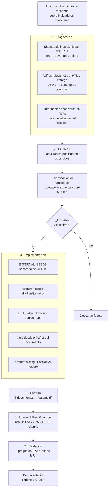

# Arquitectura del proyecto

> Diagramas de referencia de **Carvajal Corpus**: cómo fluye el dato desde la web hasta
> la respuesta del asistente, y cómo se amplió el corpus con fuentes de terceros.
> Los diagramas están en [Mermaid](https://mermaid.js.org/): se renderizan en GitHub,
> GitLab y VS Code (extensión *Markdown Preview Mermaid Support*).

## 1. Pipeline completo (captura → RAG → interfaz)

```mermaid
flowchart LR
  subgraph FUENTES["Fuentes"]
    S1["config.SEEDS<br/>15 URLs oficiales<br/>carvajal.com"]
    S2["config.EXTERNAL_SEEDS<br/>6 URLs de terceros<br/>prensa económica"]
  end

  subgraph BRONZE["Bronze"]
    WC["WebClient<br/>requests · UA propio · timeout 30 s"]
    RAW[("data/raw/<br/>HTML crudo")]
  end

  subgraph SILVER["Silver"]
    EX["extracting.py<br/>bs4 + lxml<br/>descarta nav/header/footer"]
    PROC[("data/processed/<br/>Markdown limpio")]
  end

  subgraph GOLD["Gold (versionado en Git)"]
    GD["gold.py<br/>front matter:<br/>url · title · domain · source_type"]
    G[("data/gold/<br/>21 documentos .md")]
  end

  subgraph RAG["RAG"]
    CH["Chunking<br/>1000/200 → ~118 chunks"]
    EMB["Embeddings<br/>nomic-embed-text (Ollama)"]
    IDX[("data/index/<br/>FAISS + huella SHA-256")]
    RET["Retriever k=5"]
    SP["System prompt<br/>corpus consolidado (88.7 KB)"]
    LLM["LLM<br/>DeepSeek · Claude · Ollama"]
  end

  subgraph SALIDA["Salidas"]
    CLI["CLI<br/>capture · ask · eval · status"]
    UI["Streamlit<br/>localhost:8501"]
    EV["Evaluación<br/>30 preguntas → docs/resultados.md"]
  end

  S1 --> WC
  S2 --> WC
  WC --> RAW --> EX --> PROC --> GD --> G
  G --> CH --> EMB --> IDX --> RET
  G --> SP
  RET --> LLM
  SP --> LLM
  LLM --> CLI
  LLM --> UI
  LLM --> EV
```

**Lectura:** la capa **gold** es el contrato del proyecto y la única que se versiona; el
índice vectorial se deriva de ella y se cachea. Nada de RAG toca la web: consume `data/gold/`.

## 2. Actualización del corpus con fuentes de terceros

## 3. Capas y tecnologías

| Capa | Herramienta | Rol |
|------|-------------|-----|
| Entorno y dependencias | `uv` + `uv.lock` | Entornos reproducibles, lockfile versionado |
| Lenguaje | Python 3.13 | Runtime del paquete y las apps |
| Captura | `requests` | Sesión única, `User-Agent` identificable, `timeout` |
| Extracción | `beautifulsoup4` + `lxml` | HTML → Markdown descartando *chrome* |
| Corpus | `data/gold/*.md` | Entregable versionado con *front matter* |
| Chunking | `langchain-text-splitters` | `RecursiveCharacterTextSplitter` 1000/200 |
| Embeddings | Ollama · `nomic-embed-text` | Vectores locales, sin costo por token |
| Índice | FAISS (CPU) | Búsqueda por similitud, cacheada en `data/index/` |
| Orquestación LLM | LangChain | Cadenas de prompt, retriever y LLM |
| LLM | DeepSeek (`deepseek-chat`), Claude, Ollama | Respuesta con temperatura 0 |
| Interfaz | Streamlit | Campo de pregunta + área de respuesta |
| CLI | `argparse` | `capture` · `ask` · `eval` · `status` · `list` |
| Calidad | Ruff · `ty` · pytest · pre-commit | Estilo, tipos y pruebas antes del commit |
| Automatización | Makefile (GNU Make 4.4.1) | Interfaz única de comandos |
| CI/CD | GitHub Actions · Dependabot | Paridad local ↔ CI, dependencias al día |
| Agente | OpenCode | Sesiones de desarrollo asistido |

## 4. Cronología del proyecto

| # | Commit | Hito |
|---|--------|------|
| 1 | `0c6ab14` | Captura inicial del corpus (15 URLs, patrón Medallion) |
| 2 | `42cb6c1` | Primera aplicación RAG (LangChain + FAISS + Streamlit) |
| 3 | `c4977c8` | LLM configurable: Claude vía API |
| 4 | `6f033ad` | Corrección del extractor: 2.45 MB → 64.5 KB de texto limpio |
| 5 | `da9fe8b` | Corpus consolidado en el prompt + evaluación de 25 preguntas |
| 6 | `0624bea` | DeepSeek como proveedor principal (API compatible con OpenAI) |
| 7 | `01d4c4f` | Makefile portable en Windows |
| 8 | `7417f92` | Variables desde `.env` |
| 9 | `3800fc9` | Exclusión de regiones Elementor y limpieza de chunks |
| 10 | `2820ab8` | Mejora del prompt y resultados de las 25 preguntas |
| 11 | `0eb63be` | Índice FAISS persistido (la app arranca en segundos) |
| 12 | `477e382` | Fuentes de terceros para indicadores financieros |
