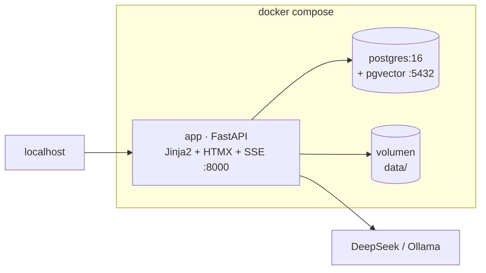

# 0001 — Stack y arquitectura de la app de chat

- **Estado**: propuesto
- **Fecha**: 2026-11-08
- **Reemplaza**: —

## Contexto

Hoy la interfaz es un prototipo en Streamlit (`app.py` + `ui.py`), donde cada
interacción re-ejecuta el script: no hay sesiones, ni trabajos en segundo plano,
ni concurrencia real. La captura funciona bien como CLI y no necesita cambiar.

La app que queremos ofrecer en producción es un **chatbot RAG sobre el corpus
propio**. Dimensiones proyectadas:

| Variable | Valor | Consecuencia |
|---|---|---|
| Usuarios registrados | 100 000 | Es una tabla, no un problema de cómputo |
| DAU (5 %) | 5 000 | |
| Concurrentes en pico (3–5 % del DAU) | 150–250 | 3–6 réplicas de app |
| Peticiones en pico | 10–20 req/s | Trivial para FastAPI |
| Chunks del corpus | 20 000–50 000 | pgvector con HNSW sobra |
| Tokens por día | ~57 M | **el costo dominante** |

Restricciones:

- Equipo de 1–2 personas; la operación debe ser mínima.
- Un solo lenguaje en el repositorio (Python).
- Despliegue objetivo en un **VPS propio**; por ahora, todo en local con Docker.
- La captura sigue siendo un proceso batch (rate limit y `robots.txt`).

## Opciones

| # | Opción | Costo | Techo |
|---|---|---|---|
| A | **Monolito modular Python: FastAPI + Jinja2 + HTMX + Postgres/pgvector** | Bajo: un lenguaje, un contenedor | Alto para este dominio; la UI rica exige más trabajo manual |
| B | Next.js + FastAPI separados | Medio: dos lenguajes, dos despliegues | Alto, pero duplica el stack sin necesidad |
| C | Microservicios + Kafka + Kubernetes | Muy alto | Alto, sin ninguna métrica que lo justifique |

Se descartan B y C: B añade un runtime que el equipo no necesita mantener, y C no
tiene un número actual que la respalde.

## Decisión

**Opción A**: una sola aplicación Python que sirve HTML (Jinja2 + HTMX) y JSON,
con Postgres + pgvector como única fuente de verdad, SSE para el streaming del
chat y la captura fuera de la web (`carvajal capture` por CLI o cron).

### Contenedores (local, `docker compose`)



En el VPS, Caddy termina TLS y hace `reverse_proxy` a `app`. Sin CDN ni WAF en
esta etapa.

> **Actualización 2026-11-14:** el despliegue demo actual usa la IP y el puerto
> `8080`, sin Caddy, porque el VPS comparte nginx con otros sitios. Ver
> [`docs/despliegue-ovh.md`](../despliegue-ovh.md).

### Stack

| Capa | Elección |
|---|---|
| Web + API | FastAPI + Jinja2 + HTMX + Tailwind (una imagen, un runtime) |
| Persistencia | Postgres 16 + SQLAlchemy 2.0 + Alembic |
| Vectores | pgvector (HNSW) |
| Autenticación | Authlib (OIDC: Google/GitHub) + sesiones de servidor en Postgres |
| Streaming | SSE con la extensión `sse` de HTMX |
| LLM | Puerto `LLMProvider`; LangChain queda como un adaptador |
| Ingesta | CLI (`carvajal capture`); worker solo si un run pasa de 5 min |
| Cuotas y caché | Tabla `usage_day` en Postgres; Redis solo cuando el volumen lo pida |
| Observabilidad | structlog + Sentry; métricas de tokens por usuario |
| Despliegue | Docker Compose en local; VPS con Caddy en producción |

### Núcleo modular

```text
packages/core/src/carvajal/
├── domain/         # modelos y reglas puras (sin IO)
├── application/    # casos de uso + puertos (Protocol)
└── adapters/       # fetching, extracting, rag, storage, llm
```

Los casos de uso dependen de `Protocol`s, nunca de `httpx`, `psycopg` ni
LangChain. Cambiar de proveedor o de almacén es escribir un adaptador.

## Decisiones resueltas (2026-11-08)

| Punto | Decisión |
|---|---|
| Frontend | **HTMX + Jinja2**, sin Node |
| Autenticación | **Authlib + OIDC** con sesión de servidor (Auth.js descartado: requiere Node) |
| Streaming | **SSE** desde el MVP |
| Conversaciones | **Se persisten** desde la fase 1 (usuario y asistente) |
| Base de datos | **Postgres + pgvector desde la fase 1**, sin paso intermedio por SQLite |
| Alcance del producto | Solo conversación; cada cita muestra **preview del documento** al hacer hover y enlace al documento completo |

## Consecuencias

**A favor**

- Un solo lenguaje y un solo contenedor que operar: despliegue y depuración simples.
- Sesiones, concurrencia y streaming real, que Streamlit no da.
- Escala horizontal sin reescribir: la app es sin estado (la sesión vive en la base).
- El esfuerzo se concentra donde está el costo: cuotas por usuario y caché de prompt.

**En contra**

- La UI rica (hover, progreso, animaciones) se hace a mano con HTMX.
- Sin sistema de componentes: hay que mantener plantillas y clases de Tailwind.
- Se renuncia a ecosistema JS (gráficas interactivas, editores) salvo integrarlos a mano.

## Disparadores para revisar

| Señal | Umbral | Acción |
|---|---|---|
| Tráfico de lectura | >1 000 req/s o >50 GB | Réplica de lectura y particionado de mensajes |
| Ingesta | >10 minutos por corrida | Worker dedicado con cola |
| Costo de tokens | >US$1 000/mes | Routing de modelo, compresión de contexto, caché agresiva |
| Corpus | >5 M chunks | Evaluar almacén vectorial dedicado |
| Producto | Se necesita UI tipo SPA (editores, gráficas densas) | Reevaluar un frontend separado (ADR nuevo) |
