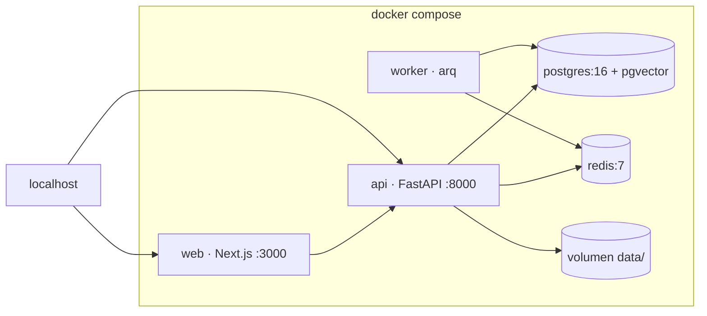

# 0001 — Stack y arquitectura de la app de chat

- **Estado**: propuesto
- **Fecha**: 2026-11-08
- **Reemplaza**: —

## Contexto

Hoy la interfaz es un prototipo en Streamlit (`app.py` + `ui.py`), donde cada
interacción re-ejecuta el script: no hay sesiones, ni trabajos en segundo plano,
ni concurrencia real. La captura funciona bien como CLI y no necesita cambiar.

La app que queremos ofrecer en producción es un **chatbot RAG sobre el corpus
propio**, con estas dimensiones proyectadas:

| Variable | Valor | Consecuencia |
|---|---|---|
| Usuarios registrados | 100 000 | Es una tabla, no un problema de cómputo |
| DAU (5 %) | 5 000 | |
| Concurrentes en pico (3–5 % del DAU) | 150–250 | 3–6 réplicas de API |
| Peticiones en pico | 10–20 req/s | Trivial para FastAPI |
| Chunks del corpus | 20 000–50 000 | pgvector con HNSW sobra |
| Tokens por día | ~57 M | **el costo dominante** |

Restricciones:

- Equipo de 1–2 personas; la operación debe ser mínima.
- Despliegue objetivo en un **VPS propio**; por ahora, todo en local con Docker.
- Sin presupuesto para una plataforma de orquestación.
- La captura sigue siendo un proceso batch (crawl con rate limit y robots.txt).

## Opciones

| # | Opción | Costo | Techo |
|---|---|---|---|
| A | Monolito Python: FastAPI + Jinja2 + HTMX, SQLite, FAISS | Muy bajo, un lenguaje | Medio: la UI rica y el streaming se vuelven artesanales |
| B | **Next.js + FastAPI + Postgres/pgvector + Redis, worker de ingesta** | Medio, dos lenguajes | Alto: escala horizontal sin reescribir |
| C | Microservicios + Kafka + Kubernetes | Muy alto | Alto, pero sin ningún número que lo justifique hoy |

Se descarta C: no existe una métrica actual que el diseño A o B no cubran.

## Decisión

**Opción B**, con dos matices que evitan la sobreingeniería:

1. **La captura no vive en la web.** Sigue siendo `carvajal capture` por CLI o
   cron, que ya funciona. Eso elimina cola, worker y scheduler del camino
   crítico; el worker queda solo para ingesta de embeddings.
2. **Una sola región y un solo Postgres.** Multi-región y sharding cuando exista
   un SLA que lo exija.

### Contenedores (local, `docker compose`)



En el VPS, un reverse proxy (Caddy) termina TLS y enruta a `web` y `api`. No se
introduce CDN ni WAF en esta etapa.

### Stack

| Capa | Elección |
|---|---|
| Web | Next.js (App Router) + TypeScript |
| API | FastAPI + Pydantic v2 |
| Persistencia | Postgres 16 + SQLAlchemy 2.0 + Alembic |
| Vectores | pgvector (HNSW) |
| Caché, cuotas y cola | Redis |
| Ingesta | Worker `arq` (1 réplica) |
| LLM | Adaptador propio sobre la API compatible con OpenAI; gateway (OpenRouter/LiteLLM) cuando haya más de un proveedor |
| Auth | Proveedor gestionado (OIDC) |
| Observabilidad | OpenTelemetry + Sentry; trazas de LLM para el costo |
| Despliegue | Docker Compose en local; VPS con Caddy en producción |

### Núcleo modular

El paquete Python actual se reordena en capas, sin cambiar su comportamiento:

```text
packages/core/src/carvajal/
├── domain/         # modelos y reglas puras (sin IO)
├── application/    # casos de uso + puertos (Protocol)
└── adapters/       # fetching, extracting, rag, storage, llm
```

Los casos de uso dependen de `Protocol`s, nunca de `httpx`, `psycopg` ni
LangChain. Cambiar de proveedor o de almacén es escribir un adaptador.

## Consecuencias

**A favor**

- Sesiones, concurrencia y streaming real, que Streamlit no da.
- Escala horizontal sin reescribir: la API es sin estado.
- El esfuerzo se concentra donde está el costo: cuotas por usuario, caché de
  respuestas y caché de prefijo de prompt.
- El CLI y el patrón Medallion (bronze/silver/gold) se conservan.

**En contra**

- Dos lenguajes en el repositorio (Python + TypeScript).
- Tres piezas de estado que operar: Postgres, Redis y un volumen.
- Autenticación delegada a un tercero.

## Disparadores para revisar

| Señal | Umbral | Acción |
|---|---|---|
| Tráfico de lectura | >1 000 req/s o >50 GB | Réplica de lectura y particionado de mensajes |
| Ingesta | >10 minutos por corrida | Segundo worker |
| Costo de tokens | >US$1 000/mes | Routing de modelo, compresión de contexto, caché agresiva |
| Corpus | >5 M chunks | Evaluar un almacén vectorial dedicado |
| Concurrencia | 100 K concurrentes (no registrados) | Revisar el diseño completo |

## Preguntas abiertas (a discutir antes de implementar)

- [ ] ¿Frontend en Next.js o monolito HTMX? Afecta el tiempo de la fase 1.
- [ ] ¿Proveedor de identidad: gestionado (Clerk/Auth0) o Auth.js propio?
- [ ] ¿Streaming por SSE o respuestas completas con *polling* en el MVP?
- [ ] ¿Historial de conversaciones persistido desde la fase 1, o efímero?
- [ ] ¿Postgres desde el inicio o SQLite en la fase 1 y migración posterior?
- [ ] ¿Se expone el corpus completo al usuario o solo a través del chat?
