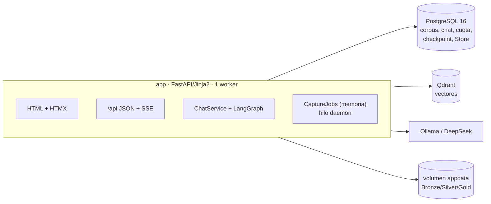

# 0002 — Una sola aplicación y paso a tres workers de Uvicorn

- **Estado**: propuesto (el goal del owner ordena operar con 3 workers; la activación
  efectiva ocurre en la fase 047 tras verificar la coordinación de captura)
- **Fecha**: 2026-11-20
- **Reemplaza**: —

## Contexto

El repositorio tiene una sola aplicación FastAPI/Jinja2 que sirve la interfaz y la API en
el mismo proceso (`apps/api/main.py`), con PostgreSQL como almacén relacional, Qdrant como
único índice vectorial, Ollama/DeepSeek como proveedores y LangGraph para el agente. El
despliegue objetivo es un único host con `compose.prod.yml` (app + Postgres + Qdrant +
Ollama), sin Redis, Celery ni microservicios.

Hoy el despliegue corre **un worker** de Uvicorn: el `CMD` de la imagen ejecuta
`uvicorn apps.api.main:app` sin `--workers` y el Compose no lo sobreescribe. Con un solo
proceso, el estado en memoria del proceso es, de hecho, estado global de la aplicación:

- El registro de capturas (`CaptureJobs`) guarda jobs, exclusión de captura activa y
  límite por IP en memoria; el hilo de captura vive en ese proceso.
- Las cachés `@cache` (settings, embedder, LLM, cliente de Qdrant, runtime del agente) se
  construyen una vez por proceso.
- El checkpointer y el Store del agente abren conexiones propias a PostgreSQL.
- La cuota diaria y la identidad ya son compartidas (PostgreSQL y cookie firmada con
  `SESSION_SECRET`), así que no dependen del proceso.

El owner pide operar con **exactamente 3 workers** de Uvicorn en el despliegue objetivo,
sin añadir servicios, porque el trabajo de chat es mayoritariamente de espera de red (LLM,
embeddings, Qdrant) y un único proceso serializa las capturas y puede quedar bloqueado por
una operación larga. La pregunta no es si Uvicorn soporta varios workers —lo hace— sino qué
estado deja de ser único cuando hay tres procesos.

El inventario de la arquitecture actual, con rutas, CLI, eventos SSE, modos y fuentes de
verdad, está en
[`specs/042-linea-base-arquitectura/inventario.md`](../../specs/042-linea-base-arquitectura/inventario.md).

## Arquitectura actual

## Opciones

| # | Opción | Costo | Techo |
|---|---|---|---|
| A | Mantener 1 worker y apoyarse solo en `asyncio` | Nulo | No cumple el requisito del owner; una captura o un turno largo compite con el resto en un proceso |
| B | **3 workers de Uvicorn en el mismo servicio, con el estado compartido movido a PostgreSQL** | Bajo: sin servicios ni dependencias nuevas; hay que mover jobs/límite de captura y revisar presupuestos | Alto para este dominio: 3 procesos en un host, escalado vertical/horizontal sin cambiar el código |
| C | Gunicorn con workers de Uvicorn | Medio: dependencia nueva y configuración redundante | El mismo que B, sin ventaja |
| D | Réplicas separadas del contenedor/nuevos servicios (cola, Celery, Redis) | Alto: operación y nuevas dependencias | Se descarta por el requisito de no añadir servicios |

## Decisión

**Opción B**: seguir con **una sola aplicación** y ejecutarla en el despliegue objetivo con
**exactamente 3 workers** de Uvicorn (`uvicorn … --workers 3`). No se añade ningún servicio
ni framework.

Reglas que la decisión impone:

1. **El estado compartido vive en PostgreSQL.** Los jobs de captura, su progreso, la
   exclusión de una captura activa global y el límite por IP dejan de vivir en memoria del
   proceso y se persisten en las tablas existentes (fase 047). Cualquier worker puede
   responder `GET /configuracion/captura/{job_id}` y su stream SSE.
2. **La captura se ejecuta en un worker y su progreso se publica en PostgreSQL.** El worker
   que crea el job es dueño de la ejecución; si el proceso muere, el job queda detectado
   como interrumpido y se recupera desde un punto seguro e idempotente (`sync` ya no
   duplica documentos), sin prometer reanudación exacta por URL.
3. **Los caches por proceso se aceptan como duplicación barata.** Settings, embedder, LLM,
   cliente de Qdrant y grafo se construyen una vez por worker. No se comparten.
4. **Los presupuestos se revisan con tres procesos.** Como punto de partida: un pool
   SQLAlchemy por worker (5 conexiones base + 10 de desborde) más las conexiones del agente
   y del Store; `max_connections` de PostgreSQL debe quedar por encima de la suma con
   margen. La memoria se mide en el entorno real; no se promete un número sin medirlo.
5. **`/live` sigue sin tocar la base** y `/health` conserva su contrato
   (`status`, `documents`, `chunks`, `index`). Con tres workers, cualquier worker puede
   responder ambos.
6. **La reversión es un cambio de variable.** `UVICORN_WORKERS=1` en el entorno del
   servicio `app` y recrear el contenedor devuelve el despliegue a un worker. El estado
   persistido (PostgreSQL, Qdrant, volumen `appdata`) no se toca, así que no se pierde
   nada; una captura en vuelo puede quedar interrumpida y se recupera como en (2).

La activación en `compose.prod.yml` es condición de la fase 047: primero se verifica con
PostgreSQL real que solicitudes simultáneas no inician dos capturas, que el límite por IP
se comparte, que el progreso sobrevive a la reconexión y a la caída de un worker, y que la
recuperación no duplica documentos. Solo entonces el Compose fija `UVICORN_WORKERS` con
valor por defecto 3.

## Consecuencias

**A favor**

- Un solo runtime y un solo despliegue: no hay que operar colas, workers externos ni
  servicios nuevos. La captura y el chat no comparten un único proceso bloqueante.
- El estado crítico (corpus, chat, cuota, captura) queda en PostgreSQL, que ya es la fuente
  de verdad relacional y ya tiene backups en el runbook.
- La reversión a 1 worker es barata y no destructiva.

**En contra**

- Más memoria y más conexiones al mismo PostgreSQL (3× caches y pools).
- El estado en memoria accidental deja de ser válido: cualquier estructura global nueva
  debe ser explícitamente compartida o tratada como caché reconstruible.
- La captura ya no puede suponer que existe un único proceso vivo; necesita detección de
  jobs interrumpidos.
- Uvicorn `--workers` requiere un punto de entrada compatible con `spawn`/`fork`; la
  aplicación sigue creándose al importar `apps.api.main:app`, sin efectos de red.

## Disparadores para revisar

| Señal | Umbral | Acción |
|---|---|---|
| Conexiones a PostgreSQL | > 80 % de `max_connections` | Reducir pools o pasar a PgBouncer (ADR nuevo) |
| Memoria del host | Workers + servicios > 80 % de RAM | Volver a 1–2 workers o revisar caches |
| Capturas concurrentes | Se necesitan capturas simultáneas | Diseñar cola con un servicio nuevo (ADR nuevo; hoy el requisito es una sola captura global) |
| Latencia de chat | p95 no mejora con 3 workers | Reevaluar el número de workers con medición |
| Necesidad de escalar a otro host | Un host no alcanza | Réplicas del servicio con estado compartido (ADR nuevo) |
