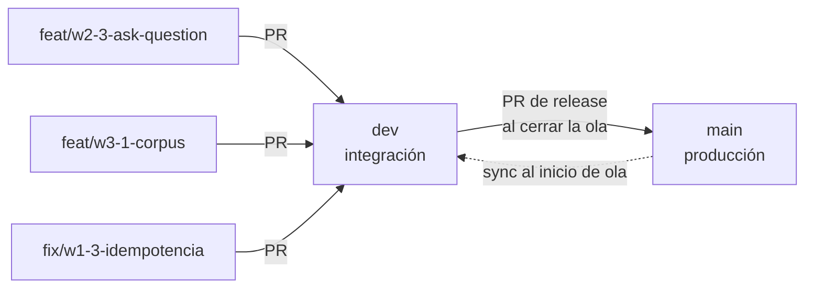
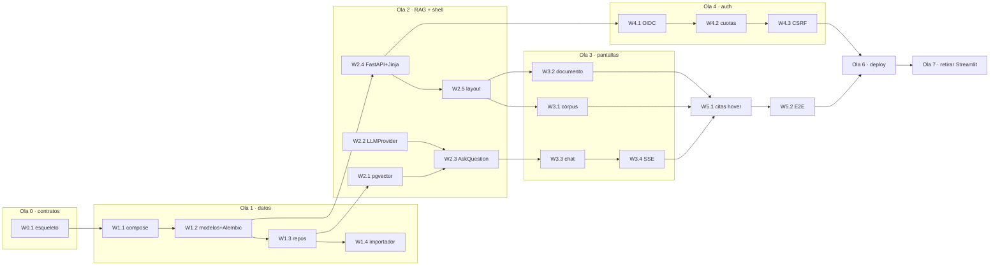

# Plan de implementación — migración a la app web

> Acompaña al [ADR-0001](../decisions/0001-stack-app-chat.md). Define **cómo** se
> construye: en qué orden, en qué PRs, con qué agentes y cómo se verifica.

## 1. Reglas del juego

| Regla | Valor |
|---|---|
| Presupuesto por PR | **≤ 300 líneas cambiadas** (add + del) |
| Excepción | **≤ 700** solo para dependencias, migraciones o scaffolding |
| Un PR | Un objetivo del plan, un ID, un dueño |
| **Base de los PRs** | **`dev`** (no `main`) |
| Merge | Lo hace **el owner**; ningún agente mergea (`AGENTS.md`) |
| Verde para pedir aprobación | CI `Calidad` + tests de la ola + E2E aplicable |
| Rama | `tipo/id-corto`, p. ej. `feat/w2-3-ask-question` |
| Commit | Conventional Commits, referenciando el ID del plan |

Si un PR necesita más presupuesto, **se parte**, no se justifica. La única
excepción legítima es "esto es una migración de base de datos".

### 1.1 Estrategia de ramas



- **`dev`** es la rama de integración: recibe todas las PRs de la migración.
- **`main`** solo recibe releases: un PR `dev → main` al cerrar cada ola
  verificable (olas 1, 3, 5 y 7).
- **Sincronización**: al inicio de cada ola, `main` se mergea hacia `dev` para no
  arrastrar divergencia.
- **Docs y decisiones** (este plan, el ADR) van directo a `main`: no son código
  de la app.
- Ambas ramas tienen ruleset: `main` exige rama al día, `dev` no (para evitar
  rebases constantes con 3 agentes). En las dos, el merge lo hace el owner.

## 2. Roles

| Rol | Quién | Hace | No hace |
|---|---|---|---|
| **Owner** | Alejandro | Aprueba, decide alcance, mergea, define prioridades | No escribe el plan detallado |
| **Coordinador** | Agente | Mantiene el DAG, asigna, revisa cada PR, corre E2E, reporta | **No mergea**, no reescribe el trabajo ajeno sin pedirlo |
| **Implementador** | Agentes (1 por PR) | Escribe código + tests en su rama/worktree | No toca archivos compartidos ni otras pistas |

### Checklist del coordinador (por PR)

```bash
# 1. Presupuesto y alcance
gh pr diff <n> --name-only          # ¿toca solo los archivos de su pista?
gh pr view <n> --json additions,deletions   # ¿dentro de 300/700?

# 2. Calidad
uv run ruff check . && uv run ruff format --check . && uv run ty check
uv run pytest -q

# 3. Integración real (cuando aplique)
docker compose -f compose.test.yml up -d --wait
uv run pytest -q -m integration

# 4. E2E de la ola (cuando aplique)
make e2e

# 5. Criterios de aceptación del plan (checklist del PR)
# 6. Etiquetar y avisar al owner; NO mergear
gh pr edit <n> --add-label ready-for-owner
```

## 3. Paralelismo entre agentes



### Reglas de convivencia

1. **Un worktree por agente** (`tools.opencode.worktree_create`), rama propia,
   sin compartir directorio de trabajo.
2. **Mapa de propiedad de archivos**: cada pista escribe en su carpeta y en
   ninguna otra.
3. **Archivos compartidos** (`pyproject.toml`, `Makefile`, `compose*.yml`,
   `.github/workflows/**`): solo los toca el **coordinador**, o se agrupan en un
   PR de integración al cierre de la ola.
4. **Máximo 3 implementadores en paralelo.** Más agentes no aceleran: saturan la
   revisión y aumentan los conflictos.
5. **Orden de merge = orden de la ola.** Un PR que depende de otro no se aprueba
   antes que su predecesor.

| Pista | Carpetas que posee |
|---|---|
| Datos | `packages/core/src/carvajal/adapters/storage/**`, `migrations/**` |
| RAG | `.../adapters/vector/**`, `.../adapters/llm/**`, `.../application/ask.py` |
| Web | `apps/api/templates/**`, `apps/api/static/**`, `apps/api/views/**` |
| Auth | `apps/api/auth/**`, `apps/api/middleware/**` |
| Infra | `infra/**`, `Dockerfile`, `compose*.yml` |

## 4. Olas y PRs

### Ola 0 — Contratos (secuencial, 1 agente)

| ID | Objetivo | Alcance | LOC | Aceptación |
|---|---|---|---|---|
| W0.1 | Esqueleto de workspace y CI | `apps/`, `packages/`, `Makefile`, workflow con jobs `unit`/`integration` | 250 | `make check` sigue verde; el paquete actual no cambia de comportamiento |
| W0.2 | Configuración tipada | `packages/core/src/carvajal/infrastructure/settings.py` (pydantic-settings) reemplaza los globales de `config.py` | 280 | Mismos valores por defecto; test de carga por entorno |
| W0.3 | Dominio puro | `domain/entities.py`, `domain/rules.py` (slug, sección, dedupe, hash) | 300 | Tests de reglas sin IO; `models.py` pasa a reexportar |
| W0.4 | Puertos | `application/ports.py`: `DocumentRepository`, `ChunkRepository`, `VectorStore`, `LLMProvider`, `Fetcher`, `Extractor` | 240 | Tests de contrato (fakes) que cualquier adaptador debe pasar |

### Ola 1 — Persistencia (2 agentes)

| ID | Objetivo | Alcance | LOC | Aceptación |
|---|---|---|---|---|
| W1.1 | Postgres local | `compose.yml`, `make db`, servicio en CI | 200 | `make db` levanta Postgres 16 con pgvector y pasa healthcheck |
| W1.2 | Esquema + migraciones | `adapters/storage/tables.py`, `migrations/` (Alembic) | 480 | `alembic upgrade head` desde cero; test de migración reversible |
| W1.3 | Repositorios | `adapters/storage/repositories.py` | 350 | Integración con testcontainers: CRUD de documentos, chunks y versiones |
| W1.4 | Importador | `cli.py: migrate-gold` | 300 | Cargar `data/gold/**` dos veces no duplica; conteos coinciden con `index.jsonl` |

### Ola 2 — RAG y shell web (3 agentes en paralelo)

| ID | Objetivo | Alcance | LOC | Aceptación |
|---|---|---|---|---|
| W2.1 | pgvector | `adapters/vector/pgvector_store.py` + índice HNSW | 350 | Búsqueda top-k con filtro por sección y capa; recall verificado con corpus real |
| W2.2 | Puerto LLM | `adapters/llm/deepseek.py`, `adapters/llm/ollama.py` (LangChain detrás) | 320 | Respuesta y streaming con un doble de prueba; sin red en tests |
| W2.3 | Caso de uso | `application/ask.py` (retrieval + prompt + citas) | 300 | Devuelve respuesta + citas con `chunk_id`, sin depender de FastAPI |
| W2.4 | Shell web | `apps/api/main.py`, plantillas base, estáticos, Tailwind | 300 | `/health` y `/` responden; `uvicorn` arranca sin Streamlit |
| W2.5 | Layout | Navegación, cabecera, tema de marca | 220 | Captura visual revisada; sin regresiones de accesibilidad básica |

### Ola 3 — Pantallas (3 agentes)

| ID | Objetivo | Alcance | LOC | Aceptación |
|---|---|---|---|---|
| W3.1 | Corpus | Lista, filtros por sección/capa, paginación | 300 | 50 documentos por página; filtros combinables |
| W3.2 | Documento | Render Markdown, metadatos, versiones | 260 | Markdown sanitizado; enlace a versión anterior |
| W3.3 | Chat | Formulario, persistencia de conversación, historial | 400 | Recargar conserva la conversación |
| W3.4 | SSE | Stream de tokens y cierre | 300 | Primer token <2 s; degradación a respuesta completa si falla |

### Ola 4 — Autenticación y cuotas (2 agentes, paralela a la ola 3)

| ID | Objetivo | Alcance | LOC | Aceptación |
|---|---|---|---|---|
| W4.1 | OIDC | `apps/api/auth/**`, sesión en Postgres, middleware | 450 | Login Google/GitHub; sesión revocable; logout limpia cookies |
| W4.2 | Cuotas | `usage_day`, límite diario, página de límite | 300 | Al agotar, 429 con hora de reinicio; contador por usuario |
| W4.3 | Hardening | CSRF por doble cookie, cookies `HttpOnly`/`SameSite`, cabeceras | 200 | POST sin token CSRF rechazado; tests de cabeceras |

### Ola 5 — Citas y E2E

| ID | Objetivo | Alcance | LOC | Aceptación |
|---|---|---|---|---|
| W5.1 | Preview de cita | `GET /fragments/citation/{id}` + hover HTMX | 250 | Hover muestra título, sección y 3 líneas; clic abre el documento |
| W5.2 | E2E | Playwright + `compose.test.yml` + 3 escenarios | 400 | Los escenarios de §7 pasan en CI |

### Ola 6 — Despliegue

| ID | Objetivo | Alcance | LOC | Aceptación |
|---|---|---|---|---|
| W6.1 | Imagen | `Dockerfile` multi-stage, `compose.prod.yml` | 250 | Imagen <300 MB; arranque <20 s |
| W6.2 | Proxy y runbook | `infra/Caddyfile`, `docs/runbook-vps.md` | 150 | `docker compose up` en un VPS queda servido con TLS |
| W6.3 | Observabilidad | structlog, Sentry, métrica de tokens por usuario | 250 | Cada request con `request_id`; error de prueba aparece en Sentry |

### Ola 7 — Retiro del prototipo

| ID | Objetivo | Alcance | LOC | Aceptación |
|---|---|---|---|---|
| W7.1 | Borrar Streamlit | `app.py`, `ui.py`, dependencia, Makefile | ~100 (−600) | `grep -r streamlit` vacío; CI verde |

### Ola 8 — Releases a `main`

| ID | Objetivo | Alcance | LOC | Aceptación |
|---|---|---|---|---|
| W8.1 | Release de la ola 1 | PR `dev → main` | 0 | Importador idempotente sobre el corpus real |
| W8.2 | Release de la ola 3 | PR `dev → main` | 0 | E2E-1 y E2E-2 en verde |
| W8.3 | Release de la ola 5 | PR `dev → main` | 0 | E2E-3 y E2E-4 en verde |
| W8.4 | Release final | PR `dev → main` | 0 | Streamlit retirado; runbook del VPS probado |

**Total: 27 PRs de código + 4 releases, ~8 300 líneas.** Ninguna ola supera las 3
semanas de un agente.

## 5. Definition of Done (por PR)

- [ ] Presupuesto de líneas respetado (o excepción justificada en la descripción)
- [ ] CI verde: `ruff`, `ty`, `pytest`
- [ ] Tests nuevos: unitarios para reglas, integración para persistencia
- [ ] Criterios de aceptación del plan cumplidos (checklist en la PR)
- [ ] Sin `TODO` sin issue asociado
- [ ] Docs: `CONSTITUTION.md` si cambia estructura; ADR si cambia una decisión
- [ ] E2E de la ola en verde, si la ola tiene escenario
- [ ] Etiqueta `ready-for-owner` y **sin merge**

## 6. Gates de CI

| Job | Cuándo | Qué bloquea |
|---|---|---|
| `Calidad` | Siempre | Ruff, `ty`, tests unitarios |
| `integration` | Olas 1–3 | Postgres real vía testcontainers |
| `e2e` | Olas 3, 5, 6 | Playwright sobre `compose.test.yml` |
| `size` | Siempre | Comenta y etiqueta si el diff >700 líneas |

## 7. Escenarios E2E

| ID | Escenario | Ola |
|---|---|---|
| E2E-1 | Sin sesión → login → pregunta → respuesta con ≥1 cita → hover muestra preview → clic abre el documento | 3–5 |
| E2E-2 | Recargar la página conserva la conversación y su orden | 3 |
| E2E-3 | Cuota agotada → 429 con hora de reinicio; la UI lo muestra | 4 |
| E2E-4 | `docker compose up` en limpio → `/health` en <60 s → chat responde | 6 |

## 8. Riesgos

| Riesgo | Impacto | Mitigación |
|---|---|---|
| LangChain sigue acoplado | Alto | W0.4 fija el puerto antes de tocar `rag.py`; W2.2 es el único punto que lo importa |
| SSE se bufferea detrás del proxy | Medio | `flush_interval -1` en Caddy; prueba con `curl -N` en W3.4 |
| Conflictos en `pyproject.toml` | Alto | Single-writer: solo el coordinador; dependencias en PR de integración |
| Migraciones rompen el presupuesto de líneas | Medio | Excepción documentada; se separan en W1.2 |
| Auth redirige mal en local vs VPS | Medio | `redirect_uri` por entorno; prueba en W4.1 con dos hosts |
| Agentes pisan plantillas compartidas | Alto | Mapa de propiedad; PR de integración por ola |

## 9. Cadencia

| Ola | Días de agente | Paralelismo |
|---|---|---|
| 0 | 3–4 | 1 |
| 1 | 4–5 | 2 |
| 2 | 5–6 | 3 |
| 3 | 6–8 | 3 |
| 4 | 4–5 | 2 (en paralelo con 3) |
| 5 | 3–4 | 1 |
| 6 | 3–4 | 2 |
| 7 | 1 | 1 |

Con 3 agentes y el coordinador revisando: **~4–5 semanas de calendario**.
