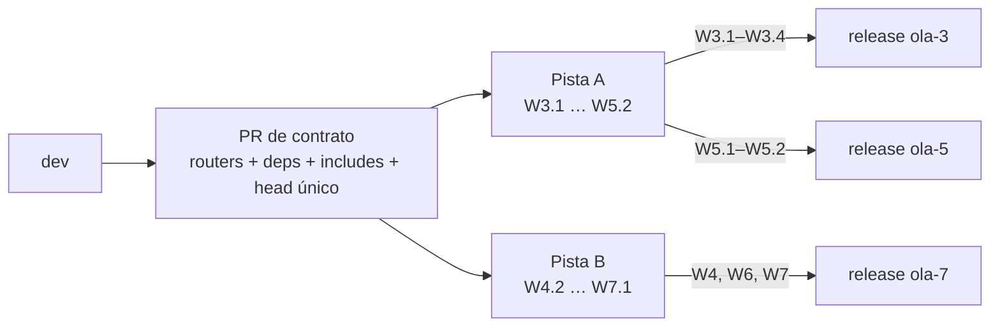

# Plan 0002 - Dos pistas para cerrar la migración

> Continúa [0001](0001-migracion-app.md), que define el orden por olas y el
> presupuesto. Este plan **no reemplaza** esas reglas: cambia la unidad de
> entrega. Las olas 3 a 7 se agrupan en **dos pistas** con contratos fijados
> antes de empezar, para que dos personas trabajen en paralelo sin bloquearse.
> Los IDs del plan 0001 (`W3.1`, `W4.2`, …) se conservan.

## 1. Por qué dos pistas

El plan 0001 suponía tres agentes por ola. En la práctica el trabajo lo hacen
dos personas, y la coordinación cuesta más que el paralelismo que aporta. La
condensación busca tres cosas:

1. **Una sola costura por tema**, fijada por escrito antes de dividir.
2. **Nadie espera a nadie**: cada pista arranca con lo que ya está en `dev` o en
   la rama de integración de la ola anterior.
3. **Un punto de sincronización**: `dev`. No hay ventanas de bloqueo ni
   reuniones de traspaso; el estado se lee en las PRs.

## 2. Reparto

| | **Pista A — Producto** | **Pista B — Plataforma** |
|---|---|---|
| Dueño | Alejandro | Marko |
| Olas absorbidas | 3 y 5 | 4, 6 y 7 |
| PRs | W3.1 corpus · W3.2 documento · W3.3 chat · W3.4 SSE · W5.1 citas · W5.2 E2E | W4.2 cuotas · W6.1 imagen · W6.3 observabilidad · W4.1 OIDC · W4.3 CSRF · W7.1 retiro |
| Presupuesto | ~1 900 líneas | ~1 700 líneas |
| Release | `ola-3` (W8.2) y `ola-5` (W8.3) | `ola-7` (W8.4, cierre) |
| Rutas que posee | `/`, `/corpus`, `/documentos/{slug}`, `/ask`, `/fragmentos/{id}` | `/auth/*`, `/cuenta`, `/health` (ampliado) |

El reparto es por **capa**, no por ola: A toca lo que se ve, B lo que se opera.
Así el conflicto de archivos es mínimo y la revisión cruzada es natural (A
revisa seguridad e infraestructura; B revisa pantallas y accesibilidad).

## 3. Contratos compartidos

Los fija el **PR de contrato**, se mergea antes de dividir y después nadie lo
vuelve a tocar.

| Contrato | Artefacto | Regla |
|---|---|---|
| Composition root | `apps/api/main.py`, `apps/api/deps.py`, `apps/api/routers/` | `main.py` solo monta estáticos y registra routers; cada pista añade **una línea** `include_router` y nunca edita el router ajeno |
| Handlers | `deps.get_handlers(request)` | Los routers reciben `Handlers` por dependencia; las pruebas inyectan dobles con `app.state.handlers` |
| Identidad de conversación | `conversations.owner_key TEXT NOT NULL` | UUID de cookie firmada (`HttpOnly`, `SameSite=Lax`, sin PII). **No es autenticación**: solo delimita historial y cuotas |
| Migración a OIDC | `conversations.user_id` y `usage_day.owner_key` | Aditiva: al primer login, `UPDATE … SET user_id = ? WHERE owner_key = ?`; sin migración destructiva |
| CSRF | `apps/api/templates/_csrf.html` | `index.html` la incluye con `ignore missing`; B crea el parcial cuando llega W4.3 y A no cambia su formulario |
| Navegación | `apps/api/templates/_nav_extra.html` | `base.html` la incluye con `ignore missing`; B añade «Mi cuenta» sin editar la cabecera |
| Extensión de `<head>` | `` | Para metadatos o scripts de una página concreta |
| Cabeza de Alembic | `tests/test_migrations_single_head.py` | Dos revisiones paralelas fallan en CI; quien mergea segundo ejecuta `alembic merge` (un archivo) |
| CI | `ci.yml` intacto | A crea `e2e.yml`; B crea `docker.yml`. Nadie edita `ci.yml` si puede evitarlo |
| Dependencias | `pyproject.toml` | Cada pista añade las suyas en su primer PR (A: Playwright; B: structlog, sentry-sdk, authlib). Conflicto trivial en el merge |

## 4. Orden de trabajo

**Pista A (producto)**

```
W3.1 corpus → W3.2 documento → W3.3 chat con historial → W3.4 SSE → W5.1 citas → W5.2 E2E
```

W3.3 usa `owner_key` desde el primer día; no espera a la autenticación. W3.4
parte `AskQuestion` en recuperación y generación (hoy retiene una conexión
durante la llamada al LLM; el streaming lo hace inevitable).

**Pista B (plataforma)**

```
W4.2 cuotas → W6.1 imagen → W6.3 observabilidad → W4.1 OIDC → W4.3 CSRF → W7.1 retiro
```

W4.2 se indexa por `owner_key`, así que **no depende de OIDC**. W4.1 va después
de la imagen y las trazas porque es la única tarea con dependencia externa
(registro de la app OAuth, redirect URIs, a veces DNS): si esa espera aparece,
se solapa con el trabajo de A. W7.1 cierra la pista, cuando las pantallas ya
cubren el flujo completo.

## 5. Diagrama de dependencias



Las dos pistas salen del contrato y no se apuntan entre sí. El único cruce es
`owner_key` (contrato de datos, no de código).

## 6. Reglas de convivencia

Se suman a las del plan 0001 §3 (mapa de propiedad, un PR por objetivo, base
`dev`, merge del owner, sin rebase sobre ramas publicadas).

| Regla | Detalle |
|---|---|
| Propiedad de archivos | `templates/**`, `static/**`, `routers/chat.py`, `routers/corpus.py`, `routers/fragments.py` son de A; `apps/api/auth/**`, `apps/api/middleware/**`, `Dockerfile`, `compose*.yml`, `infra/**`, `routers/auth.py` son de B |
| Revisión cruzada | Cada uno aprueba las PRs del otro; el autor nunca aprueba ni mergea lo suyo |
| Rondas de revisión | **Máximo dos** por PR. A partir de ahí, el hallazgo se descarta con justificación en el hilo. Sin esto, el bot infla cada PR hasta el límite de 700 |
| Presupuesto | 300 blando / 700 duro. Si un ID se pasa, se parte en dos PRs; no se justifica |
| Errores de B en rutas de A | El middleware devuelve un **fragmento HTML** (`class="aviso"`) cuando llega `HX-Request`; la zona `#respuesta` ya pinta cualquier HTML |
| Sincronización | `dev`; sin ramas de larga vida. La pila de una ola abierta usa una rama de integración como base y se retargetea al mergear |

## 7. Riesgos y follow-ups

| Riesgo | Mitigación |
|---|---|
| Coincidencia en `main.py` | Routers por área y un solo `include_router` por pista |
| Coincidencia en `base.html` | Includes con `ignore missing`; B crea los parciales |
| Dos cabezas de Alembic | Test de cabeza única + `alembic merge` al integrar |
| Cuotas antes de auth | Cubo por `owner_key`; migra a `user_id` sin cambiar la tabla de consumo |
| OIDC bloqueado por registro externo | Va al final de B, después de imagen y trazas |
| Retirar Streamlit demasiado pronto | W7.1 cierra la pista B, tras W3.1–W3.4 y W5.1 en `dev` |
| `rag.py` y FAISS | Retirar Streamlit **no** retira `rag.py` (lo usa la CLI `ask/eval/summarize/faq`). Migrar la CLI fuera de FAISS es un follow-up aparte, no parte de W7.1 |
| Conexión retenida durante el LLM | A lo resuelve al partir `AskQuestion` en W3.4, donde el streaming lo exige |

## 8. Cierre de cada pista

Una pista está cerrada cuando:

1. Sus PRs están en `dev` con CI en verde y sin hilos abiertos.
2. El release a `main` (`W8.2`, `W8.3` o `W8.4`) está mergeado y etiquetado.
3. Los follow-ups que haya dejado están escritos en la PR de release.

El cierre de una pista **no** espera al de la otra: los releases son
independientes y `dev` es siempre el punto de integración.
